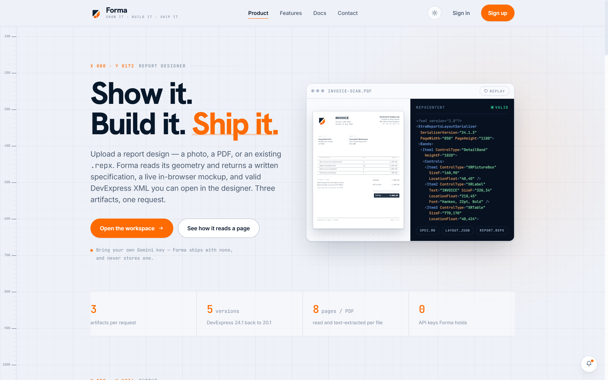
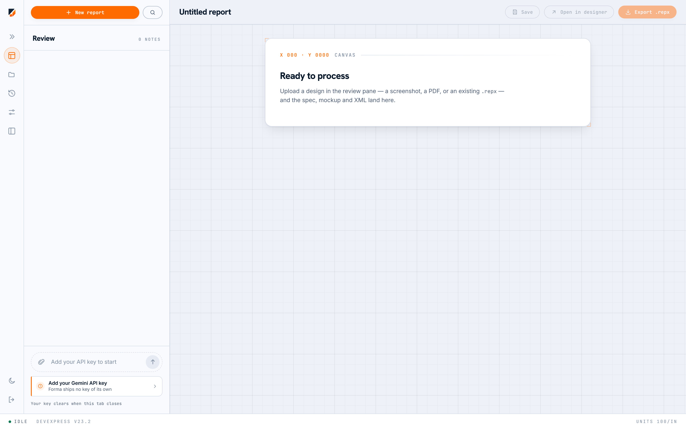

# Forma

Turn a screenshot, a PDF, or an existing report into a real DevExpress `.repx` file.

[](LICENSE)
[](#prerequisites)
[](tsconfig.json)
[](package.json)
[](package.json)

[](https://github.com/waqarsyd/forma/actions)
[](https://github.com/waqarsyd/forma/actions/workflows/live.yml)

Upload a design — a mockup, a scanned invoice, a photo of a printout, or a `.repx` you already have — and Forma returns three things in one pass:

- **`repxContent`** — valid `XtraReportsLayoutSerializer` XML that saves as a `.repx` and opens directly in the DevExpress Report Designer,
- an **in-browser mockup** of its bands, so you can see what it understood before you download anything,
- a **specification**, band by band, of what it holds.

The AI writes only the `.repx`; Forma reads the mockup and the specification out of it, so all three describe the file you download and your tokens are not spent writing it three times ([`src/lib/repxViews.ts`](src/lib/repxViews.ts), since 2026-11-05).

---

## Why this exists

Rebuilding an existing report in the DevExpress designer is mechanical work: read the layout, place the bands, set the units, repeat. Forma does the transcription pass so you start from a `.repx` that already has the right control types and geometry, and spend your time on the parts that need judgement.

It is built around one constraint that shaped everything else: **the application owns no API key.** An earlier build inlined a build-time Gemini key into the shipped JavaScript, and Google's secret scanner found and revoked it. What replaced it is not a patch but an architecture — the browser calls Google directly with a key the user supplies, and no server is ever in the loop.

---

## Demo

**Live at [openforma.web.app](https://openforma.web.app)** — built from `main` and deployed by hand, so it can trail the newest commits: the page names the commit it was built from in `<meta name="forma-version">`, and a daily check ([`live.yml`](.github/workflows/live.yml)) says when it is behind `main`. What changed, and when, is on the [changelog](https://openforma.web.app/changelog). It runs signed out with no account, and generating a report needs a Gemini API key of your own, which you paste into Settings and which never leaves your browser.



The workspace itself — the uploaded design and the conversation on the left, the rendered mockup on the right, and the `Mockup` / `Spec` / `REPX` tabs over the three artifacts:



Both are real captures of the app at `localhost:3000`, not mockups. See [`docs/media/README.md`](docs/media/README.md) for how they were taken.

---

## Table of contents

- [Why this exists](#why-this-exists)
- [Bring your own key](#bring-your-own-key)
- [Features](#features)
- [Tech stack](#tech-stack)
- [Getting started](#getting-started)
  - [Prerequisites](#prerequisites)
  - [Installation](#installation)
  - [Environment variables](#environment-variables)
  - [Running locally](#running-locally)
- [Usage](#usage)
- [Using your own Firebase project](#using-your-own-firebase-project)
- [Configuration](#configuration)
- [Project structure](#project-structure)
- [Scripts](#scripts)
- [Testing](#testing)
- [Deployment](#deployment)
- [Roadmap](#roadmap)
- [Status and limitations](#status-and-limitations)
- [Contributing](#contributing)
- [License](#license)
- [Acknowledgements and contact](#acknowledgements-and-contact)

---

## Bring your own key

**Forma ships no Gemini API key, and it never will.** Every user supplies their own, and the browser calls Google directly with it — the server is never in the loop and never sees a credential.

This is not an accident of design. An earlier build inlined a build-time key into the shipped JavaScript; Google's secret scanner found it and revoked it. The architecture that replaced it is deliberate:

| Where the key lives | Lifetime |
|---|---|
| `sessionStorage` | Erased by the browser when the tab closes |
| Firestore (opt-in, signed in) | **AES-GCM ciphertext only** |

The optional cloud copy is zero-knowledge: your key is encrypted in your browser with a passphrase derived through PBKDF2-SHA256 (310,000 iterations, per-record salt and IV). The passphrase never leaves your machine, so nobody operating a Forma deployment can read your key.

That also means **a forgotten passphrase is unrecoverable by design.** There is no reset, because a reset would imply the operator could decrypt it.

The claim is enforced, not just intended: the server sends a Content-Security-Policy whose `connect-src` allowlists the handful of origins this app legitimately talks to. A key sitting in `sessionStorage` a few components away from model-generated markdown is worth stealing, and `connect-src` is what makes a stolen one useless — injected script that cannot reach an attacker's server cannot exfiltrate anything. Adding an origin to that list is a change to this guarantee; see [`src/server/securityHeaders.ts`](src/server/securityHeaders.ts), which carries the full reasoning.

---

## Features

Each of these is a shipped code path, not a plan.

- **Image, PDF and `.repx` intake.** Drop a mockup, a scan, a photo, or an existing report. PDFs are rasterised *and* have their text layer extracted, so exact strings survive rather than being read back out of pixels ([`src/App.tsx`](src/App.tsx), [`src/lib/pdf.ts`](src/lib/pdf.ts)).
- **Your own free key opens it, and Forma's own model works behind it.** Forma ships no key of its own: it starts once your free Gemini key is in Settings, whichever AI then designs (Gemini by default, or a local AI on your own computer through Ollama or LM Studio, or OpenRouter's free models), and until then the chat box is locked (the owner's rule since 2026-11-05; from 2026-11-02 it worked with no key). Forma learned the house style and the kinds of report from the structure of 359 real DevExpress reports (never their words), and that model stands in when the AI cannot answer. It also remembers how you work: say "remember: always use A4 and Tahoma" and every report after follows it, and the reports you keep teach it your house style, all kept in your browser and listed in Settings ([`src/lib/offlineGenerator.ts`](src/lib/offlineGenerator.ts), [`docs/proposals/own-model.md`](docs/proposals/own-model.md)). With an AI chosen, the parts work together on each request: OCR reads the words, Forma's own vision model (when you run one) reads the layout, Forma's own model brings the house style, and if the AI cannot answer you get Forma's own draft instead of an error ([`src/lib/formaTeam.ts`](src/lib/formaTeam.ts)). For a picture, Forma drafts the report and the AI only corrects the draft, one short line per control, so a report costs a fraction of the tokens of one the AI designs from nothing ([`src/lib/draftText.ts`](src/lib/draftText.ts), since 2026-11-05).
- **One chat box for everything.** Attach or paste an image, a scan, a PDF or a `.repx`, describe the report you want, or both, and the box works out what to do: an attachment shows as the file alone, and once you send, its text is read with OCR behind the scenes in the browser (PaddleOCR's PP-OCRv5 for an English page since 2026-11-10, in browser workers, and Tesseract.js for the other languages; nothing leaves the browser; English, Arabic, Hindi, Urdu, French, German or Spanish, the language worked out from the page itself), the image viewer offering a review of what was found over the source from which a `.repx` can be built with no model; a description with no attachment gets a question or two in the thread when it leaves something open, then a report designed from it; words and an attachment together go to one generation ([`src/components/Composer.tsx`](src/components/Composer.tsx), [`src/lib/ocrAttach.ts`](src/lib/ocrAttach.ts), [`src/lib/promptToReport.ts`](src/lib/promptToReport.ts)).
- **The AI writes the `.repx`, and Forma reads the rest off it.** Since 2026-11-05 the model answers with the REPX as plain XML and nothing else; the spec and the mockup's `layout` are read off that file ([`src/lib/repxViews.ts`](src/lib/repxViews.ts)), which more than halved what each report asks the model to write. A cut-off answer is detected and repaired rather than downloaded half-written ([`src/lib/repxTruncation.ts`](src/lib/repxTruncation.ts)).
- **Targets your DevExpress version** — eight of them, 26.1 back to 20.1, written into the file's `SerializerVersion` so it drops into the codebase you already have. Worth knowing that the tag is a *label rather than a gate*: a newer `.repx` still opens in an older designer, which was measured with `RepxProbe inspect` and then confirmed through the product — a 23.2 file opened correctly in a real 20.1 designer, and the designer rewrote the tag on save. So pick the version you build against; nothing is lost if you pick wrong.
- **In-browser mockup** drawn from the `layout` JSON, so you can see what the model understood before downloading anything.
- **Print preview and PDF export**, and it is the one pane drawn from `repxContent` rather than from the `layout`. The exported REPX is read back, the band rules applied — Detail once per record, PageHeader and PageFooter on every sheet, ReportHeader once, ReportFooter after the last record — and laid out across real pages at true size, so `window.print()` gives a correctly-scaled PDF. **This is what closes the loop:** before it, nothing showed the report paginated and nothing checked the artifact you actually download. A Detail band the height of the page looks fine in the mockup and is obvious here on sight, one record per sheet ([`src/lib/reportPreview.ts`](src/lib/reportPreview.ts), [`src/components/ReportPreview.tsx`](src/components/ReportPreview.tsx)). Export, at the top right, holds that PDF with every other format; beside it, **PDF with outline** writes a PDF of Forma's own: the report's bookmarks as its outline, encrypted under the report's passwords when it has any, and PDF/A-1b, 2b or 3b when the report asks for it, with Liberation fonts embedded and checked with veraPDF ([`src/lib/pdfWriter.ts`](src/lib/pdfWriter.ts), [`src/lib/pdfA.ts`](src/lib/pdfA.ts)).
- **Direct manipulation.** Select, drag, resize; double-click a label to retype it; arrow keys nudge one report unit and Shift+arrow ten, because a drag gets close and one unit at a time gets exact. Undo is one entry per gesture, not per mouse move. Every edit splices the control's opening tag in place, so attributes Forma does not model — `Padding`, `StylePriority`, anything a later DevExpress version adds — survive untouched ([`src/lib/repxEdit.ts`](src/lib/repxEdit.ts)).
- **Data binding, where the report stops being a picture.** Paste a JSON row, a CSV export, a `CREATE TABLE` statement or a plain list of column names — the format is detected from its shape, not chosen from a dropdown. Forma reads the field names, types and a sample value, proposes which report column each belongs to, and lets you correct every pairing before anything is written. Apply writes `ExpressionBindings` onto the mapped Detail cells, plus a `TextFormatString` where a column is plainly money or a date ([`src/lib/dataSource.ts`](src/lib/dataSource.ts), [`src/lib/repxBindingPlan.ts`](src/lib/repxBindingPlan.ts), [`src/components/DataBinding.tsx`](src/components/DataBinding.tsx)).
- **Grouped reports.** When the source breaks its rows into runs by a shared value — a "North Region" heading inside the table, a subtotal repeating partway down — the output carries `GroupHeaderBand` and `GroupFooterBand` with a `<GroupFields>` collection naming the field the rows break on, and a per-group subtotal whose `<Summary>` carries `Running="Group"`. The prompt states a *visible* test for grouping rather than leaving it to judgement, and says to omit both bands when the design shows no break ([`src/lib/reportBands.ts`](src/lib/reportBands.ts)).
- **Report parameters.** A "Date range: ___ to ___" line or a filled-in criteria block becomes a real `<Parameters>` collection, used in the report's `FilterString` (`?DateFrom`) or in a control expression (`[Parameters.Region]`). **The type is the one thing the model cannot write correctly, and it fails silently** — DevExpress accepts `Type="System.DateTime"` inline and loads a `System.String` holding the date as text, so the filter then compares strings. The real form is a `#Ref-N` pointer into an `<ObjectStorage>` block, so the prompt asks for the readable inline type and the conversion happens in code ([`src/lib/repxParameters.ts`](src/lib/repxParameters.ts)).
- **Charts and cross-tabs.** A chart becomes a real `XRChart` with a series bound to the fields the axes name, not a picture of one assembled from labels and rectangles; a matrix whose rows *and* columns are both data values becomes an `XRCrossTab` with its three field collections. Bar, line, area, scatter and pie. The preview draws both as **structure and binding rather than invented data** — a bar outline captioned "Amount by Region" — because plotting made-up numbers on a page someone is checking for accuracy is worse than plotting none.
- **Batch intake — a folder of legacy reports in, a queue of `.repx` out.** Each source document becomes *its own* report, which is the opposite of attaching several files to the composer, where several pages build one report. Choose files or a folder, or drop either on the panel ([`src/lib/folderDrop.ts`](src/lib/folderDrop.ts) opens a folder to its last file). Files run one at a time by default because your key carries the quota and forty parallel requests turn a slow success into a fast 429; two or three at once are offered for a key that allows it. Each row shows the audit's verdict, since the point of running forty files is knowing which are worth opening. **Download as .zip** takes them all ([`src/lib/batchQueue.ts`](src/lib/batchQueue.ts), [`src/lib/zip.ts`](src/lib/zip.ts) — a store-only writer in ~150 lines rather than a ~30 kB dependency, verified by opening its output with .NET's own `ZipFile` reader). **This is the migration story, and the one thing a prompt-driven competitor structurally cannot offer**: you can describe one report to an assistant, but not forty you have never read.
- **An audit that says what is still wrong** after every repair has run — errors mean content will be lost when DevExpress loads the file, warnings mean it opens and is a worse report than it should be. A chart with no series and a cross-tab missing a field collection both load happily and print an empty frame that reads as "the data has not arrived yet", so both are reported ([`src/lib/repxAudit.ts`](src/lib/repxAudit.ts)).
- **Runtime model detection.** Models are probed against a preference list on first use and the winner is cached for the session. Nothing is hardcoded, because Google retires models "for new users" — a pinned id keeps working for existing projects and 404s for every new key (`resolveModel` in [`src/services/geminiService.ts`](src/services/geminiService.ts), covered by `modelResolution.test.ts` beside it, with the curated preference list in [`src/lib/modelCatalog.ts`](src/lib/modelCatalog.ts)).
- **A workspace as quiet as a chat app.** Working dots while Forma writes and **Stop** in place of the send button; no progress bar, no status bar and no pause, since 2026-11-04. The measured progress is still read to a screen reader ([`src/lib/generationProgress.ts`](src/lib/generationProgress.ts)).
- **Optional sign-in and cloud sync.** Signed out, Forma saves to `localStorage` and works fully; signed in, reports sync to Firestore under rules that enforce account isolation ([`firestore.rules`](firestore.rules)).
- **Zero-knowledge key vault.** AES-GCM encryption in the browser, PBKDF2-SHA256 key derivation ([`src/services/keyVault.ts`](src/services/keyVault.ts)).
- **Version history with a structural diff.** Every generation, refinement and binding pass is kept, each row saying what it changed — controls added, removed, moved, resized, retyped — so a refinement that made the report worse is one click from being undone. Signed in, the newest ten are saved with the project ([`src/lib/revisions.ts`](src/lib/revisions.ts), [`src/lib/revisionStore.ts`](src/lib/revisionStore.ts)).
- **Account deletion that actually deletes**, removing saved reports, their version history and the encrypted key — proven by a test running against the emulator with production rules enforced. The middle one is the part that is easy to miss: Firestore does not delete a subcollection with its parent document, so a report deleted the obvious way leaves its history behind and looks like it worked ([`tests/accountDeletion.test.ts`](tests/accountDeletion.test.ts)).
- **A shared style sheet, derived rather than asked for.** An appearance used by three or more controls is hoisted onto a `<StyleSheet>` after generation, so restyling a migrated report is one edit instead of forty that have to agree. Grouping is on exact equality, which is what makes it provably equivalent. DevExpress prints a style's value over a control's own for every property the style sets, so the lift deletes the hoisted attributes from every member and leaves nothing for the style to override ([`src/lib/repxStyles.ts`](src/lib/repxStyles.ts)).
- **A single place for unit conversion.** Four coordinate systems meet in this pipeline and every conversion between them lives in one module, because a mismatch renders a plausible layout in the wrong place and never throws ([`src/lib/reportGeometry.ts`](src/lib/reportGeometry.ts)).
- **Forma Designer, an optional Windows companion** that opens a generated `.repx` in the real DevExpress designer over a loopback listener, downloadable from [/download](https://openforma.web.app/download) and installed per user. Open in designer opens a dialog that asks the companion only when clicked and says what is missing: Forma Designer, DevExpress Reporting (whose free trial it links), the browser's permission, or Windows. Export `.repx` needs none of it ([`tools/RepxDesigner/`](tools/RepxDesigner/), [`src/lib/designerBridge.ts`](src/lib/designerBridge.ts), [`src/components/OpenInDesigner.tsx`](src/components/OpenInDesigner.tsx)).
- **Mock mode** — `VITE_FORMA_MOCK=true` returns a canned invoice after a 3s delay, for exercising loaders and progress bars without spending a request.

---

## Tech stack

| Layer | Choice |
|---|---|
| UI | React 19, Tailwind v4 (no config file — CSS-first), Motion for animation |
| Build | Vite 6, esbuild for the server bundle |
| Language | TypeScript, `strict` enabled |
| Server | Express 4 — the **same** `server.ts` in development and production |
| AI | `@google/genai`, called from the browser |
| Auth & storage | Firebase Auth + Firestore, both optional |
| Documents | `pdfjs-dist` for PDF intake, `react-markdown` + `remark-gfm` for the spec |
| Tests | Vitest, `@firebase/rules-unit-testing` against the Firestore emulator |

There is no ESLint config, no state-management library, no date library, no HTTP client (native `fetch`), and no icon package — the icons are inline SVG.

---

## Getting started

### Prerequisites

- **Node 20, 22, or 24+** (developed on Node 24.21.0 / npm 11.19.0). "20+" is the wrong shorthand: Vitest supports `^20 || ^22 || >=24`, so the odd-numbered lines **21 and 23 are outside the supported range** even though they are newer than 20.
- **A Gemini API key** from [Google AI Studio](https://aistudio.google.com/apikey) — supplied in the app at runtime, never in a file.
- **A JRE** — only for `npm run test:rules`, which starts the Firestore emulator (a JVM process). A runtime is enough; no JDK.
- **A Firebase project** — only if you want sign-in and cloud sync. Everything else works without one.

<sup>`package.json`'s `engines` field is the declaration; **three** files restate it in prose — this one, [`CONTRIBUTING.md`](CONTRIBUTING.md) and [`CLAUDE.md`](CLAUDE.md) — so raising the floor touches four files in all. (`CLAUDE.md` says "three files" and means the prose copies.)</sup>

### Installation

```bash
git clone https://github.com/waqarsyd/forma.git
cd forma

npm install
```

Contributors should use `npm ci` instead — it installs exactly what the lockfile specifies and fails if `package.json` and `package-lock.json` disagree, which is a check nothing else performs.

### Environment variables

**All four are optional, and none is a secret.** Copy [`.env.example`](.env.example) to `.env` only if you need one of them; `server.ts` loads it via `dotenv/config`.

| Name | Required | Default | Description |
|---|---|---|---|
| `VITE_FORMA_MOCK` | No | unset | Set to `"true"` to skip Gemini entirely and return a canned mock invoice after a 3s delay. Local development only. The value `"misordered"` returns the same fixture with its two header bands swapped, so the REPX audit's band-order warning can be seen firing in the running app; `"true"` stays deliberately clean. |
| `PORT` | No | `3000` | The port the server listens on. Useful for a second instance beside a running dev server; a value that is not a port falls back to 3000. |
| `HOST` | No | loopback in dev, all interfaces in production | Which interface the server binds. Set to `0.0.0.0` only to reach the dev server from another device — that publishes Vite's module graph to anything that can reach the machine. |
| `HTTPS` | No | unset | Set to `"true"` **only where TLS actually terminates**, so the server sends HSTS. Never set it locally: a browser that receives HSTS on `http://localhost` refuses plain-HTTP localhost for a year afterwards, breaking every other project on the machine. |

> **A `GEMINI_API_KEY` in `.env` does nothing.** `vite.config.ts` allowlists `VITE_*` only, so it reaches neither the server nor the browser. It just sits in your working tree waiting to be committed. The key belongs in the app's Settings dialog.

### Running locally

```bash
npm run dev
```

Open <http://localhost:3000/workspace>; the locked message box's button opens **Settings** at **Gemini key**, where the key you paste takes effect at once.

That's enough to generate reports. Sign-in and cloud sync are optional — signed out, Forma saves your projects to `localStorage` and works fully.

> **Never run `vite dev` directly.** The dev server is [`server.ts`](server.ts), an Express app that runs Vite in middleware mode. `npm run dev` is the entry point.

---

## Usage

**Generate a report from a design:**

1. `npm run dev`, then open <http://localhost:3000/workspace>.
2. **Settings → Gemini key** → paste your key. It goes to `sessionStorage` and is erased when the last Forma tab closes.
3. Attach an image, a scan, a PDF or a `.repx` to the message box, describe the report you want, or both.
4. Send. Working dots show while the AI writes, and **Stop** ends it; the report opens over the whole bench when it is done.
5. Check it in **Preview**, ask the chat for changes, then take the `.repx` from **Export**.

**Develop against a canned response, spending no quota:**

```bash
echo 'VITE_FORMA_MOCK="true"' > .env
npm run dev
```

**Serve a production build:**

```bash
npm run build      # client bundle + server bundle into dist/
npm start          # node dist/server.cjs — must run from the repo root
```

**Mirror dev-server output to a file** (useful when something needs reading back rather than watching):

```bash
npm run dev:log    # same server; output tee'd to dev-server.log (gitignored)
```

**Open a generated `.repx` in the real DevExpress designer** (Windows, optional): download Forma Designer from [the download page](https://openforma.web.app/download), or build it from [`tools/RepxDesigner/`](tools/RepxDesigner/), and double-click it to install it for your user. **Open in designer** then hands the report over, from the website or a Forma running on your PC, and says what is missing when something is. It needs DevExpress Reporting 20.1 or later on the same PC. Start it from your own desktop — a process launched elsewhere paints on a desktop nobody can see. See its [README](tools/RepxDesigner/README.md).

---

## Using your own Firebase project

Sign-in and cloud storage need a Firebase project. Skip this entirely if you only want local use.

1. Create a project at [console.firebase.google.com](https://console.firebase.google.com/) and register a **Web app**.
2. **Authentication → Get started → Sign-in method → Google → Enable.** The tabs stay hidden until you click *Get started*, which is the usual stumbling block.
3. **Authentication → Settings → Authorized domains** — confirm `localhost` is listed, and add your deployment domain.
4. **Firestore Database → Create database** (production mode).
5. Put your web config into `firebase-applet-config.json`, and make sure `firestoreDatabaseId` there matches `databaseId` in `firebase.json` — **a mismatch silently talks to the wrong database.**
6. Set the deploy target in `.firebaserc`, then `npx firebase deploy --only firestore:rules`.

`.firebaserc` is what decides the deploy target. `firebase use <id>` only sets the CLI's own per-directory state, so a stale `.firebaserc` will happily deploy to the wrong project from a fresh shell or from CI.

**The `AIzaSy…` string committed in `firebase-applet-config.json` is correct and should stay.** A Firebase web API key is a public project identifier, not a secret — it ships in every Firebase web app by design, and `firestore.rules` plus the authorized-domain list are what actually protect your data. It is not the same class of value as a Gemini key.

**Restrict it anyway, by HTTP referrer, before your repository is public.** Public by design is not the same as unlimited: an unrestricted key is accepted from any origin, so anyone who finds it can spend your project's quota. Rules still stop them reading your data — this is a cost problem, not a data one — but GitHub is crawled for `AIzaSy` strings, so the window opens the moment the repo is. GCP Console → APIs & Services → Credentials → *Browser key (auto created by Firebase)* → Application restrictions → HTTP referrers.

Two traps in that list, both of which fail silently:

- **Include your `authDomain`** — `<project>.firebaseapp.com/*`. Google sign-in runs through `/__/auth/handler` on that domain using this key, so a list of just your own site breaks sign-in and nothing else, which is a hard symptom to trace back.
- **The list replaces, it does not append.** Adding a production domain later means re-sending every entry that must keep working.

Verify it rather than assuming: a `GET` to `identitytoolkit.googleapis.com/v1/recaptchaParams?key=…` with a forged `Referer` should answer `403 Requests from referer … are blocked`, and the same call with an allowed one should answer `200`. Restrictions take a few minutes to propagate.

---

## Configuration

Beyond the environment variables above, two things are configurable.

**`firebase-applet-config.json`** — your Firebase web config. `firestoreDatabaseId` must match `databaseId` in [`firebase.json`](firebase.json).

**Report settings**, set per report in the app's config modal and persisted through an explicit allowlist in [`src/lib/reportConfigStore.ts`](src/lib/reportConfigStore.ts):

| Option | Description |
|---|---|
| Report unit | The measurement system the generated `.repx` uses. Every conversion between coordinate systems goes through [`reportGeometry.ts`](src/lib/reportGeometry.ts). |
| Paper size and orientation | Page geometry for the generated report. |
| `thinkingBudget` | A lever on how long the model reasons before emitting output. Unset by default. |

**Right to left** and the **stored procedure** the data comes from are set under *Direction and data source* (since 2026-11-04). Right to left applies with or without a key: the report is mirrored however it was made. A data schema is pasted in the **Data** tab rather than here. See [`docs/PRD.md`](docs/PRD.md) §2.4.

---

## Project structure

<details>
<summary>Directory tree with per-entry notes</summary>

```
src/
  App.tsx              the workspace and the chat, loaded on /workspace
  PublicSite.tsx       every public page and the sign-in dialog, without
                       the workspace (the entry since 2026-11-08)
  main.tsx             entry point: PublicSite, or App on /workspace, the
                       offline banner and the offline worker's registration
  index.css            tokens, marketing pages, shared chrome (Tailwind v4, no config file)
  workspace.css        the workspace shell only — every `wb-` class lives here
                       but the lazy menus', in components/overlays.css
  vite-env.d.ts        Vite's ambient types; the one file here not in
                       PascalCase.tsx / camelCase.ts form, because Vite names it
  components/          LandingPage, FeaturesPage, DocsPage, ContactPage,
                       ChangelogPage (/changelog, every release),
                       LoginPage, LegalPage (/terms, /privacy and /accessibility),
                       InfoPage and InfoRoutePage (/security, /pricing, /examples,
                       /compare, /about, /self-host and /faq, their words in
                       infoPages.tsx, the FAQ in faqs.tsx, which Docs shows too),
                       publicPages.tsx (which page a public route draws, shared
                       by PublicSite and App),
                       SiteHeader, SiteFooter, MobileNav, Logo,
                       AccountDialog, UserAvatar, NotFoundPage,
                       OcrDialog (the review the image viewer opens: the text
                       OCR read, its detected layout drawn over the source,
                       and Build .repx with no model),
                       SettingsDialog (Settings as ChatGPT's: General, AI,
                       Gemini key and Memory, a change taking effect as it is
                       made), in the frame SectionedDialog draws for it and
                       for AccountDialog, whose sections are
                       ProviderSettings (which AI answers:
                       Automatic, which is Gemini, a local AI or OpenRouter's
                       free models; Forma Offline went into Automatic on
                       2026-11-05),
                       MemorySettings (what Forma remembers, to switch off,
                       change or forget) and UsageSettings (the day's
                       requests),
                       ChatThread
                       (the review column's transcript, lifted out of App.tsx
                       once chatSession.ts held its rules — Forma's working
                       dots pass through as children, because that is generation
                       state and not conversation), Composer (staged
                       attachments, the notice lines and the box you type in;
                       one composer does both jobs, and which one is App.tsx's
                       decision, not this component's), and Markdown — which
                       is its own module so react-markdown can be lazy-loaded.
                       The workspace's panes and menus are here too, each
                       loaded on demand: ReportPreview, ReportMockup,
                       RepxViewer, DataBinding, the request card and log, the
                       selection toolbar, the command menu, the shortcuts
                       list, the right-click menu (ControlMenu), the zoom
                       field, the corner's help (HelpMenu), the Export
                       panel (ExportPanel), the title's project menu
                       (ProjectMenu), the pin beside it (PinProject), the
                       empty workspace's home
                       (HomeStart), the Share dialog (ShareDialog) and the
                       page a shared link opens (SharedReportPage), with
                       overlays.css holding those menus' styles.
                       The files that are not components are the shared
                       hooks (useFocusTrap; useLayer, which puts a menu or
                       dialog on the Escape stack; useMenuKeys, a menu's
                       arrow keys and focus return; useFitScale, the zoom
                       that fits a page to its pane), overlays.css,
                       dialogs.css (the three dialogs' shared look), ocr.css
                       and the tests:
                       legalDisclosure, which reads ContactPage and
                       index.html off disk, and the component render tests,
                       the only ones outside lib/, services/ and server/.
                       AccountDialog's mocks Firebase and covers the
                       surface — which control is enabled when, and what it
                       says when it fails; what a deletion actually removes is
                       proved separately in tests/accountDeletion.test.ts,
                       against the emulator
    landing/           figures used by the marketing pages: HeroScanner,
                       SheetRuler, StepFigures, VaultFigure,
                       AnnouncementDock, sections, icons
  lib/                 the pure helpers, nearly all under test. reportTypes
                       holds the report shape — it lives here rather than in
                       services/ so nothing in this layer has to import upward.
                       repx, sourceRect, reportGeometry (every unit conversion
                       in the pipeline, and the only place one may be written),
                       repxMargins (moves a margin the model drew as whitespace
                       into the report's own Margins and margin bands),
                       reportBands (the band skeleton the prompt asks for — a
                       real ReportHeader / PageHeader / one-row Detail /
                       ReportFooter / PageFooter; the old single page-sized
                       DetailBand and its VITE_FORMA_FLAT flag were removed on
                       2026-09-05, once the fallback could no longer produce a
                       comparable report),
                       promptSections (which optional blocks the mega-prompt
                       carries for a given request — a section is dropped only
                       when an uploaded .repx proves the feature is absent, so
                       an image or a bare instruction still gets all of them),
                       repxTruncation (did the model stop writing the XML
                       part-way, asked at the parse rather than at Export),
                       repxBindings (column headings to DevExpress field names
                       for expression bindings — derived in code so the guess
                       is testable, not left to the prompt),
                       repxStyles (hoists an appearance shared by three or
                       more controls onto a <StyleSheet>, so a migrated
                       report can be restyled in one place -- a control's
                       Borders is a style's Sides, which is the kind of
                       thing only a measurement finds),
                       repxSummaries (a total with no running scope prints
                       blank in DevExpress; scopes the ones whose band
                       decides it, and finds the rest for the audit),
                       repxGroups (nested groups nest by Level, not by file
                       order; numbers the ones written without it from the
                       top, so they do not print inside out),
                       repxCrossTabs (a cross-tab written as its fields alone
                       throws when DevExpress prints it; writes the layout
                       DevExpress generates from those fields),
                       repxDpi (DevExpress reads every band and control at
                       its own Dpi, 100 when absent; writes the report's on
                       each, so millimetre reports print at their size),
                       repxPaper (DevExpress prints on PaperKind's paper,
                       Letter when absent; names the paper the written size
                       is, so A4 and landscape reports print on it),
                       repxAudit (asks what is still wrong with the finished
                       report after every repair has run — errors mean content
                       will be lost, warnings mean it opens and is a worse
                       report than it should be),
                       repxAccessibility (the contrast, text-size and
                       alternative-text checks DevExpress's own designer runs on
                       every edit, measured from its analyzer's output and
                       appended to the audit as one warning per check),
                       reportPreview (reads the exported REPX back and lays it
                       out across real pages — Detail once per record,
                       PageHeader on every sheet — which is what the Preview
                       pane and the PDF export are drawn from),
                       pictureBox (an XRPictureBox's image and where it
                       prints, by Sizing, ImageAlignment and its own DPI, as
                       DevExpress 20.1 printed each mode),
                       netFormat (.NET composite, date and number formatting,
                       so a page number or a value previews as DevExpress
                       prints it),
                       netDecimal (.NET's decimal, so 8 x 0.5 previews as 4.0
                       and a sum of prices is exact, as DevExpress prints them),
                       criteria (DevExpress's expression language, evaluated
                       with .NET's types over the Preview's test data),
                       reportData (test rows typed by column, calculated
                       fields, parameter defaults, their print order and
                       groups, and which records each printed band's totals
                       and fields read),
                       csvExport (the report as CSV, laid out on one
                       continuous page the way DevExpress exports it --
                       byte for byte, on thirteen measured reports),
                       xlsxExport (the report as an Excel workbook: the
                       layout as a grid of merged cells, numbers and dates
                       kept as values, format strings converted -- cell for
                       cell the same as DevExpress's own workbooks),
                       pdfWriter (Forma's own PDF, written beside the
                       browser's print path so that it can carry the
                       report's bookmarks as an outline -- the outline the
                       same as DevExpress's, entry for entry),
                       pdfCrypto (that PDF encrypted under the report's own
                       passwords, AES-128, RC4 or AES-256 as DevExpress
                       encrypts its export, opened by pdf.js to check),
                       pdfA, pdfFonts and trueType (that PDF as PDF/A when
                       the report asks: the Liberation faces subset and
                       embedded as DevExpress embeds its fonts, an sRGB
                       output intent, XMP; refused with a password, as
                       DevExpress refuses it; passed by veraPDF),
                       exportItems with docxExport, rtfExport and htmlExport
                       (Word and RTF page by page as positioned frames, HTML
                       as one continuous table, each frame and cell where
                       DevExpress's own export put it),
                       paddleOcr, paddle and paddleWorker (PaddleOCR's
                       PP-OCRv5 reading an English page in browser workers:
                       one finds the text, up to four read it),
                       ocr, ocrLayout and ocrRepx (an image or a scan read
                       in the browser, by PaddleOCR or Tesseract.js: every word with its
                       box and confidence, aligned rows as an XRTable and the
                       rest as XRLabels, low-confidence text flagged),
                       ocrScript (the language of a picture worked out from its
                       reading: Arabic, Hindi, Urdu, French, German or Spanish
                       beside English, and when to try handwriting),
                       autoConfig (the DevExpress version, unit, paper, right to
                       left and stored procedure, worked out from what a request
                       brings instead of chosen in Settings),
                       textMeasure (how many lines a text breaks into and how
                       tall that prints, so the Preview grows controls and
                       breaks pages where DevExpress does),
                       revisions (the report's history, and a
                       structural diff by control name — added, removed,
                       moved, resized, retyped — because the model rewrites
                       whitespace freely and a line diff of two REPX files is
                       almost entirely noise),
                       revisionStore (that history on its way to Firestore and
                       back — one document per version in a subcollection,
                       because ten snapshots inline would break the report's
                       size budget several times over; signed out it stays in
                       memory, because localStorage is one shared quota across
                       every project),
                       mockupRows (which detail tables repeat a heading row an
                       earlier band already drew, so the Mockup draws it once —
                       a rendering rule rather than a data fix, because the
                       row's presence is what the record count is derived from),
                       workspaceView (which pane the bench shows, held in two
                       pieces of state — extracted from App.tsx so the pair
                       can be round-trip tested, because a plate present in
                       the derivation and not the setter highlights its
                       button and never opens its pane),
                       chatSession (the review column's transcript as data:
                       whether a turn is conversation or work, the history
                       the model is actually sent, and the two rewrites a
                       retry performs — generic over the report and metadata
                       types so nothing here imports upward),
                       attachmentBudget (how many files are staged and how
                       many more fit — counted as FILES, which is what an
                       eight-page PDF spending sixteen of twelve slots was
                       about),
                       batchQueue (the state of a folder of source documents
                       being turned into a report each — pending, running,
                       done, failed — and the audit verdict per row, because
                       the point of running forty files is knowing which of
                       the forty are worth opening),
                       folderDrop (a dropped or chosen folder as its files,
                       read to the end past the browser's batches of 100),
                       zip (a store-only ZIP writer, ~150 lines against a
                       ~30 kB dependency, so a batch comes back as one archive
                       instead of forty download prompts),
                       fidelity (the arithmetic of the fidelity benchmark:
                       reads bands, controls, surviving phrases, font sizes,
                       margins and the audit out of a generation and compares
                       them with a case's expectations; the runner that spends
                       quota is scripts/fidelity/run.ts),
                       reportSkeleton and formaModel (Forma's own model: a
                       report reduced to its structure with every word taken
                       out, the house style and kinds of report learned from
                       a set of skeletons, and the check that a model holds
                       no word outside its vocabulary),
                       skeletonText (a skeleton as the compact text the vision
                       model learns to write, read back tolerantly from its
                       answer, scored against the right one, and the check
                       that no word but a public font's leaves the machine),
                       boxText (the boxes design: the vision model given the
                       text read on a page as numbered boxes, and asked only
                       for its bands and each box's band and role),
                       boxReader (Forma's box reader: two small networks,
                       learned on the CPU, that put each text OCR read in its
                       band and give it its role, decoded in print order and
                       made a skeleton at the places OCR read),
                       skeletonRepx (the report a skeleton describes, its
                       words from what OCR read in each box, its values bound
                       to fields named after their column's caption),
                       offlineGenerator (a report designed by that model with
                       no AI service: the words read for kind, columns,
                       grouping and totals, the pattern chosen, the house
                       style applied, a .repx the audit passes),
                       aiProvider (which AI answers -- Automatic, which is Gemini,
                       a local AI or OpenRouter -- and when one is ready, which is
                       what opens the workspace; the
                       OpenRouter key kept like the Gemini key; Forma's vision
                       model and a page reader as helpers beside any of them),
                       fallbackChain (on a limit, the next AI the user set up
                       answers and the reply says so; never away from a local
                       AI), localModels (the Ollama pair suggested for the
                       computer's memory, and the page reader's text and the
                       question it is asked), reportFacts (the open report's
                       fields, totals, groups and bands counted from the file:
                       a plain question answered with no AI, the facts told to
                       the AI, a field the data lacks refused), docsKnowledge
                       (the Docs articles a question about Forma is given),
                       jobPlan (the plan a heavy message gets first),
                       batchCheckpoint (a batch kept in the browser to carry
                       on after a limit or a reload), repxTranslate (a report's
                       typed texts collected for translation and put back, the
                       layout untouched), previewRows (the rows the Preview
                       prints sent with a question about the data, after the
                       consent asked in the thread), chatJudge (the twenty
                       chat requests the benchmark scores, the checks code makes
                       and the judge's rubric),
                       formaTeam (one request with every part in its role:
                       the vision model's draft and the house style told to
                       the AI as hints, who took part named in the reply, and
                       Forma's own draft standing in when the AI fails),
                       memory (what the user asked Forma to remember and the
                       style of the reports they keep, never their words,
                       applied to the next report),
                       expressions (the DevExpress expression reference the
                       model is shown for Prompt-to-Expression, and the check
                       a generated expression is held to -- balance, not SQL,
                       and no field the data lacks),
                       promptToReport (the pure half of Prompt-to-Report:
                       the brief a description run
                       opens the prompt with, the follow-up answers and the
                       repair decision; the wizard is the chat box, whose
                       questions are a form in the thread, and the
                       clarification call is in geminiService),
                       repxLayout (controls past the page or their band and
                       bands taller than the page, the other half of the
                       analyzer's layout group, appended to the audit),
                       repxOverlaps (overlapping sibling controls found for
                       the audit and moved apart after a description run --
                       DevExpress's FixLayoutErrors -- through repxEdit so
                       every other byte survives),
                       runawayOutput (is the stream's tail a short fragment
                       repeated to fill 512 characters -- a model stuck on a
                       number, which the benchmark found running four minutes
                       to the output ceiling before anything noticed; the
                       stream reader cuts it off and the request is retried),
                       repxParameters (the parameters a report asks for before
                       it prints, and the lift that makes a typed one work —
                       DevExpress silently ignores an inline Type and loads a
                       String, so the real form is a #Ref pointer into an
                       ObjectStorage block, written here rather than asked of
                       the model),
                       repxEdit (move, resize and retype one control by
                       splicing its opening tag — the direct manipulation the
                       Preview pane offers, written into the REPX itself so
                       every other byte the model wrote survives; its XML
                       escaping is xmlEscape, a module of its own so the
                       Preview engine stays out of the entry chunk),
                       dataSource (reads the fields out of whatever the user
                       pastes — a JSON row, a CSV export, a CREATE TABLE or a
                       list of names — and suggests which column each belongs
                       to, so binding uses the data's own field names instead
                       of names guessed from the column headings),
                       userInstructions (an empty composer means "no request",
                       not an invented one — the two cases are different
                       prompts rather than one with a placeholder in it),
                       repxItems (ItemN is a position inside its own collection
                       and restarts at Item1 in each — a document-wide sequence
                       makes DevExpress read every collection as empty and drop
                       the tables silently),
                       repxRefs (makes the model's Ref values unique — a repeat
                       makes DevExpress alias two elements onto one and drop
                       the second's content, with no error anywhere),
                       repxRtl (the Settings checkbox's right to left, written
                       on the report root however the report was made),
                       repxGroupField (the field a group breaks on, chosen
                       above the Preview's paper, its heading following),
                       repxBindingPlan (finds the header and detail rows, proves
                       they describe the same columns, and binds the detail row
                       to one field each — declining rather than guess when the
                       two rows do not correspond),
                       repxChunks (splits a report into the bands and controls
                       an example is made of, replacing every value with a
                       placeholder on the way — a model shown an example copies
                       it, and a kept Ref makes the loader discard content),
                       embedStore (what the report library holds, what still
                       needs embedding, and what is safe to search — identity is
                       the content, so re-importing a file costs no quota and an
                       edited fragment never keeps the old text's vector),
                       vectorSearch (cosine similarity and top-k over a few
                       hundred vectors, by brute force: at this size an index
                       costs more bundle and CSP than the scan it replaces),
                       libraryDb (the library in IndexedDB — chosen over
                       localStorage because this app has already exhausted that
                       quota once, and because IndexedDB stores a Float32Array
                       natively at 4 bytes a dimension instead of ~13 characters
                       as JSON),
                       houseStyle (what a retrieval turns into: the queries a
                       draft asks, and the fenced block of examples appended to a
                       refine — formatting to copy, values never, and nothing
                       inside treated as an instruction. These five back the
                       report library in docs/proposals/rag.md, alongside
                       services/library.ts, components/LibraryPanel.tsx and
                       the rail's sixth panel in App.tsx),
                       attachments, panelSize, sidebar (the workspace sidebar
                       opening and closing as Gemini's and ChatGPT's do: the
                       phone breakpoint, Ctrl+B, the toggle's name),
                       seo (each page's title, description, preview, canonical
                       address and robots, and the sitemap, robots.txt,
                       security.txt and llms.txt), assetPaths (where the
                       OCR engine, the PDF/A fonts
                       and the models are served, in folders named for
                       their contents), staleChunks (a tab open across a
                       deploy reloads once for the new build), releases
                       (the release notes behind /changelog,
                       its Atom feed and What's new), announcements,
                       replyChanges (the chat's changes kept in the tab, so
                       a reply's Undo and Redo outlive a reload), chatTurn
                       (what the chat box keeps as a memory, sends straight
                       to a design, or reads as an answer), composerStore
                       (an unsent draft per project, and the queue, kept in
                       the tab over a reload), buildInfo (which build runs,
                       for Settings and a problem report), problemReport (a
                       GitHub issue prefilled when an area fails),
                       projectExport (every saved project in one .zip),
                       storagePersist (asking the browser to keep local
                       projects), keyHandoff (the keys reaching a new
                       tab), passwordPolicy (the
                       shortest password a form accepts), authDomain
                       (sign-in on the site's own host, prepared and off
                       until the owner's console step) and appCheck (App
                       Check with reCAPTCHA Enterprise, on since 2026-11-08,
                       enforced after a week), signOut (what a sign-out
                       removes from the tab), serviceWorker (the offline
                       worker /sw.js is written from at build),
                       licenceNotice (the
                       third-party notices /licenses.txt is written
                       from at build), docsSearch (the Docs page's
                       search over each article's words, and its feedback
                       as a prefilled GitHub issue), datetime,
                       modelCatalog, reportConfigStore, designerBridge,
                       geminiClient (loads the generation service on demand, so
                       its 19.6 kB prompt is not on every page load) and
                       modelCache (the session's resolved model — eager, because
                       a synchronous effect clears it),
                       analysisResponse (the REPX out of the AI's answer, and
                       whether a failed one was cut off or malformed),
                       repxViews (the Mockup, the Spec and the title read off
                       the REPX, which the AI no longer writes),
                       draftText (Forma's draft of a picture as the AI
                       corrects it, one short line per control, and the
                       corrected draft read back for Forma to build),
                       agentEdit (the open report as the chat's model sees
                       it, the edits it asks for made in place, and what
                       changed, read off the file), shortcuts (ChatGPT's
                       keyboard shortcuts for the chat, and Stitch's for
                       the workspace), workingTips (the tip above the box
                       while Forma works), startingPoints (the empty
                       workspace's starting points and recent projects),
                       shares (a shared report's copy, link and invitees,
                       as firestore.rules pins them), requestCount
                       (requests sent to each model today, and the
                       limits Google stated, for the chat box's model
                       picker and Settings' Usage today), modelTiers (that
                       picker's Auto, Fast and Balanced, each naming
                       its model), dataFiles (CSV, JSON,
                       Excel, Word and the rest attached in the chat,
                       read in the browser as the report's data),
                       sqlSchema + sqlSchemaScript + sqlSchemaStore (a SQL
                       Server database's layout, read from Forma's script or
                       an SSMS file with no connection, and kept on the
                       device), repxSqlDataSource (the SQL data source inside
                       a .repx), sqlQuery (what a report reads from it: a
                       table with its joins, a procedure, or checked custom
                       SQL), repxSqlWriter (that query written into the
                       report as DevExpress's SqlDataSource, by connection
                       name, as measured and run by DevExpress),
                       databaseAi (a shared database shown to the AI, the
                       query it names held to the layout), fieldMatch (a
                       column matched to a field by heading and value),
                       sqlPreview (the Preview over the database's sample
                       rows, typed as DevExpress prints each SQL type),
                       sqlDrift (a report's own data source read back, kept
                       through a redesign and checked against a newer layout),
                       sqlCompanion (the companion on your PC reading your SQL
                       Server for the Data tab and the Preview, by connection name),
                       designerRelease (the Forma Designer download's version,
                       size, SHA-256 and release, written by its packing script),
                       layers (the stack of open menus and dialogs, so one
                       Escape closes only the topmost and keys meant for
                       one stay there), clipboard (every Copy, with a
                       fallback for plain HTTP), initials (the avatar's
                       letters),
                       geminiErrors (what the user is told when a
                       request fails), savedReport + accountData (the two
                       storage shapes and the document layout),
                       tokenUsage (what a generation cost, formatted for the
                       REPX pane -- the numbers were logged to the console
                       from the day streaming landed, which turned out not to
                       count as having them),
                       contactSubmit, generationProgress (the progress's whole
                       state machine, read by a screen reader since the progress
                       card became working dots) and attachmentParts, themeTransition
                       (the circular wipe the theme toggle opens from, and its
                       fallbacks), and the routing pair router (real
                       history/location, so not pure) + routes.
                       Plus motion tokens, and pdf + genai + firebaseClient —
                       three loaders that exist so their dependencies stay out of
                       the eager bundle, and are the only files here that are not
                       pure. firestoreOps sits beside the last of them holding
                       the OperationType enum, deliberately free of any
                       firebase/* import so referencing it cannot drag the SDK
                       back into the entry chunk
  services/            geminiService (+ tests, and modelResolution.test.ts,
                       chatRetry.test.ts, generationRetry.test.ts,
                       promptToReport.test.ts, promptToExpression.test.ts
                       and testData.test.ts beside it), firebase, keyVault
                       (+ tests; the vault's storage rules are covered by
                       tests/ as well), and the report library's two:
                       embeddings (the embedding call, on the user's own key)
                       and library (import, remove and retrieve), each + tests;
                       compatClient (local AI and OpenRouter in the shape of
                       Gemini's SDK) and formaVision (Forma's vision model
                       asked through the local endpoint), each + tests;
                       pageReader (a page reader such as glm-ocr, asked for
                       a picture's text through the same endpoint)
  server/              securityHeaders, bindHost, staticCache and appRoutes
                       (+ tests) — what server.ts sends, where it listens,
                       how long dist/ is cached for, and which paths are
                       the app's rather than a 404. Under src/ but never bundled
                       into the client; server.ts is the only importer
  fonts/               the three self-hosted typefaces as variable woff2, their
                       SIL OFL licences, and a README — referenced from
                       index.css so Vite fingerprints them; see the typefaces
                       block there for why they are not in public/
tests/                 Firestore rules tests (emulator)
tools/RepxDesigner/    optional Windows companion that opens a generated .repx
                       in the real DevExpress designer — C# and MSBuild, with
                       its own README; nothing in the web app depends on it;
                       downloaded as Forma Designer (scripts/package-designer.ts)
tools/RepxProbe/       console tool that asks DevExpress what a .repx really
                       contains — `emit` prints what the serializer writes,
                       `inspect` reports what the loader sees and fails when a
                       file silently lost content; its own README too
public/                static assets served at / — the logo pair (PNG + WebP,
                       light and dark), favicon.png, and the pre-rendered
                       og-card.png
assets/source/         og-card.html, the page public/og-card.png is rendered
                       from (not deployed). The full-resolution logo masters
                       lived here until 2026-08-29; they are gitignored now —
                       2.8 MB backing 256px files already in public/
assets/model/          formaModel.json, Forma's own model, learned by
                       scripts/model/train.ts from the structure of the
                       owner's reports (never their words); served at /model/
assets/pdf-fonts/      the twelve Liberation 2.1.5 faces a PDF/A file embeds
                       and their SIL OFL licence, unmodified; served at
                       /pdf-fonts/ and copied into dist/ at build (README
                       there: provenance and checksums)
docs/                  PRD.md, design/DESIGN.md, notes/ (architecture + incident
                       history) and audit/README.md (a one-line index of the
                       2026-08-27 findings, whose IDs are cited throughout the
                       code — a dated record; read notes/ for what is current)
  media/               images the documentation links to, and the only place a
                       committed screenshot belongs; nothing here is read by the
                       build. Has its own README with the capture rules
.github/               workflows (checks.yml, which runs the seven checks plus
                       `npm ci`; codeql.yml; live.yml, which checks the live
                       site), three issue templates, a PR template,
                       dependabot.yml, CODEOWNERS, SUPPORT.md and the main
                       branch's ruleset (rulesets/main.json)
.githooks/             opt-in pre-commit guard; enable with
                       `git config core.hooksPath .githooks`
.claude/               settings.json — the committed permission allowlist, so
                       the documented checks run without prompting
scripts/               dev + build; the encoding, doc-pointer and bundle-size
                       checks that three of the seven checks call; the owner's
                       deploy.mjs (release-notes.ts writes each release's
                       notes), smoke.mjs, backup.mjs and github-setup.mjs (the
                       repository's settings, labels, milestones and roadmap);
                       make-icons.mjs and fetch-handwriting.mjs; fidelity/, the benchmark's runner and cases; and
                       model/, which learns Forma's own model and packs and
                       draws the vision model's training set (render.py needs
                       Python 3 and Pillow), with kaggle/train_vision.py, the
                       fine-tune that runs on Kaggle's free GPU, and
                       evaluate.ts, which scores its answers
server.ts              Express server, used in development and production
firestore.rules        the actual security boundary
firebase.json          the rules path, databaseId, and the emulator port
firebase-applet-config.json
                       your Firebase web config — see the Firebase section
                       above, including the databaseId that must match
                       firebase.json's
```

</details>

---

## Scripts

| Command | What it does |
|---|---|
| `npm run dev` | Express + Vite middleware on port 3000 |
| `npm run dev:log` | Same, mirrored to `dev-server.log` |
| `npm run build` | Client bundle + server bundle into `dist/` |
| `npm run build:server` | Server bundle only (`dist/server.cjs`, via esbuild) |
| `npm start` | Serve the production build (run `build` first, from the repo root) |
| `npm run preview` | Vite preview against `dist/` |
| `npm run lint` | `tsc --noEmit` |
| `npm run lint:encoding` | Fails if any source file contains mojibake |
| `npm run lint:links` | Fails if a relative link or a cited section heading in the docs does not resolve |
| `npm run check:size` | Artifact size budgets — run `build` first |
| `npm run smoke` | Checks the deployed site over the network: every route, the entry chunk, the headers, the feed, and once it runs `main`'s build, a 404 for an unknown path and a missing chunk. Read-only; `.github/workflows/live.yml` runs it daily |
| `npm run fetch:paddle` | Download PaddleOCR's text detector and English recogniser (12.7 MB, pinned by SHA-256) into `vendor/paddle/` for the next build; `scripts/deploy.mjs` runs it, and a build without it reads pictures with Tesseract alone |
| `npm run fetch:handwriting` | Download the handwriting model (about 64 MB, pinned by SHA-256) into `vendor/handwriting/` for the next build — see *Handwriting is a deploy-time decision* |
| `npm test` | Unit tests (Vitest; `node` by default, jsdom per file where needed) |
| `npm run test:watch` | The same suite in watch mode |
| `npm run test:coverage` | Coverage over `lib/` and `services/` — see the note in `vitest.config.ts` about what is deliberately excluded |
| `npm run test:rules` | Firestore security-rule tests — **needs Java** |
| `npm run bench:fidelity` | The fidelity benchmark: generates every case under `scripts/fidelity/cases` through the real pipeline with your own key (`FORMA_BENCH_KEY`) and scores the result. A benchmark, not a check — it spends quota, so it is not in CI |
| `npm run model:train` | Learns Forma's own model (`assets/model/formaModel.json`) from a folder of `.repx` reports, from their structure only, and refuses to write it if any word of theirs would reach it. Takes `--reports` and `--data` (a folder outside the repository); see `docs/proposals/own-model.md` |
| `npm run model:dataset` | Packs those skeletons as a private Kaggle dataset for the vision model: every rare font made Arial, every target checked for stray words, nothing written if one is left. Takes `--data` (more than one set allowed) and `--out` (outside the repository). Then `python scripts/model/render.py <out>` draws each skeleton as page images with placeholder text. Crystal Reports `.rpt` files become a set through `scripts/model/crystal.ps1` and `crystal.ts`, which need the Crystal runtime 13 |
| `npm run clean` | Remove `dist/` |

<sup>Two other files list these: [`CONTRIBUTING.md`](CONTRIBUTING.md)'s table of checks and [`CLAUDE.md`](CLAUDE.md)'s *Commands* block. Adding or renaming a script is a change to all three — this table is the one users read, so it lists every script rather than only the checks.</sup>

---

## Testing

```bash
npm test           # pure helpers: REPX validation, crop geometry, stream parsing, routing
npm run test:rules # security rules, against the Firestore emulator
```

Run one file with `npx vitest run src/lib/repx.test.ts`, or one case with `-t "<name>"`. Neither is meaningfully faster than the whole thing: warm, a single file and the entire suite both land around 5 seconds. Narrow for focused output, not for speed.

The unit suite deliberately targets functions whose invariants **fail plausibly rather than loudly** — a transposed crop box puts a logo somewhere believable but wrong; a mis-scanned stream shows a stray character in a chat bubble. Those are the failures that survive manual testing.

The rules suite covers account isolation, document shape, and the encrypted key vault. It needs a JVM because the Firestore emulator is a Java process; a **runtime is enough — no JDK required.** This project was developed against a Temurin **JRE 21**, installed per-user with `JAVA_HOME` and `PATH` set at user scope, so nothing had to go in system-wide and no admin rights were needed.

Coverage of React components is five files deep — `DataBinding` and `BatchPanel`, added after a state bug shipped that a render test would have caught, then `ChatThread`, `Composer` and `AccountDialog` — and `App.tsx`'s own stateful logic is covered only where pieces of it have been extracted into `src/lib`. **This is a floor, not a net.** [`docs/notes/testing.md`](docs/notes/testing.md) says exactly what is and is not covered.

<details>
<summary>If a run is slow, or every file fails at once</summary>

**Budget for a cold run being several times a warm one — an order of magnitude is normal, and it is not the ceiling.** Measured on one machine: 52s against 4.6s for the same command. Nothing is wrong when a run crawls — that is the OS file cache and `node_modules/.vite` filling up, and it is worth knowing before you go hunting for a hang. On a loaded shared machine the gap has been far wider than 10x, and past a point it stops being slowness and becomes the failure in the next section; read "ten times" as the ordinary case rather than a worst case.

**If files fail at once with `[vitest-pool-runner]: Timeout waiting for worker to respond`, that is a cold cache, not a broken install — but re-running will not fix it.** jsdom loads synchronously, while vitest allows a worker 60s to start; when the cold load exceeds that, every worker is killed *before* it finishes warming the cache, so each retry pays the same cost and dies in the same place. Warm it once outside vitest instead, in a process nothing is timing:

```bash
node -e "import('jsdom')"   # takes as long as it takes, then npm test
```

That import has been measured at 113s cold on one machine and **507s on another** (a busy shared server), against ~1.5s warm; the suite then runs green in about 4.5s. Treat the cold figure as a property of the machine rather than a constant — what is stable is the shape, one very slow first load and then a fast one, and the 60s ceiling it has to fit under. Most files now run under the `node` environment for exactly this reason, with the few that need a DOM opting in via a first-line `// @vitest-environment jsdom`; `vitest.config.ts` explains the split. If you add a test needing `document`, `localStorage`, `crypto.subtle` or `location`, add that line — forgetting fails loudly rather than silently.

This used to say "the first `npm test` of the session", which is the wrong variable. The cache survives the terminal closing, and both figures were reproduced **within one session** on 2026-08-27 — 4.1s early on, then 42s later after a build, two typechecks and an emulator run had pushed the suite's files back out of the cache. What predicts a slow run is a cold cache, not a fresh shell.

**`--reporter=basic` does not exist in Vitest 4.** An unrecognised reporter name is treated as a module to import, so the run dies with `Failed to load custom Reporter from basic` and a stack trace full of Vite frames — it reads like a broken config rather than a bad flag value. Use `--reporter=dot` for the terse output `basic` used to give.

</details>

---

## Deployment

There is no Dockerfile and no container setup. Forma builds to a self-contained Express bundle:

```bash
npm run build      # vite build + esbuild -> dist/
npm start          # node dist/server.cjs, from the repo root
```

`scripts/build-server.mjs` bakes in `NODE_ENV=production`, so the built server takes the static-file branch and the Vite import is dead code. The static path is `process.cwd()/dist`, which is why `npm start` must run from the repo root. In production the server also mounts `compression()` and serves hashed bundles with an immutable cache policy — `index.html` deliberately excepted, or a deploy would never reach a returning visitor.

Set `HTTPS="true"` **only where TLS actually terminates**, so HSTS is sent. Set `HOST` if you need to bind something other than the default.

### Firebase Hosting

**The target is Firebase Hosting, on the free Spark plan**, chosen on 2026-09-08. The app has no server state — Firestore and Gemini are both called from the browser with the user's own key — so everything `server.ts` does in production is static-host territory, and running a Node process to serve five megabytes of files buys nothing. Two things decided it over Cloudflare Pages: the *default* domain is already in the API key's referrer allowlist and Firebase Auth's authorised domains, so sign-in works there with no reconfiguration; and it is one vendor rather than two. Measured, a cold visit transfers about 490 kB, so the free tier's 360 MB/day is roughly 730 visits a day.

```bash
node scripts/deploy.mjs              # main as pushed: every check, the build, hosting AND the rules, then the live checks
node scripts/deploy.mjs --preview    # the same build on a 7-day preview channel; the live site is untouched
node scripts/deploy.mjs --dry-run    # everything but the deploy
```

**One deploy, the same every time (2026-11-07).** `scripts/deploy.mjs` refuses unless it is deploying `main` exactly as pushed (a clean tree, equal to `origin/main`), runs every check CI runs plus the rules suite, builds, deploys hosting and `firestore.rules` together, and then runs `scripts/smoke.mjs` against both sites expecting the commit it built. The site had served the build of 28 October for weeks while this file said it was `main`, and the sharing rules were never deployed with the code that needs them. It is deliberately not an npm script: the committed permission list allows `npm run *`, and a deploy must not be something an agent can start without asking. The two commands it runs are still the way by hand: `npx firebase deploy --only hosting` and `npx firebase deploy --only firestore:rules`.

**Every deploy is a numbered release (2026-11-08).** `package.json`'s version is the release a deploy publishes, and the newest entry in [`src/lib/releases.ts`](src/lib/releases.ts) carries the same one, which a test holds. Once the live checks pass, `deploy.mjs` tags the commit `v<version>`, pushes the tag, and makes the GitHub release, its notes written from `releases.ts` by `scripts/release-notes.ts`: every release since the previous version. It stops before building anything if `v<version>` already names another commit (new work under an old number: raise the version in both places) or if the newest release does not carry the version; re-deploying a tagged commit makes no new release. The release needs the GitHub CLI signed in; without it the tag is still pushed and the command to make the release is printed. `v1.0.0` (28 October) was made by hand; `v1.1.0` is the next deploy.

**Rolling back.** The Hosting console's *Release history* has a *Rollback* on every earlier release, for each site; from the command line, `npx firebase hosting:clone forma-201ba:<version id> forma-201ba:live` (and the same for `openforma`) puts a listed version back. The rules are not versioned by Hosting: deploy them from the commit before, `git show <commit>~1:firestore.rules > firestore.rules` and `npx firebase deploy --only firestore:rules`, then restore the file. A preview channel (`--preview`) is the way to look at a build before it is anyone's.

**PaddleOCR's models are fetched at deploy.** Since 2026-11-10 an English page is read by PaddleOCR's PP-OCRv5 models in the browser, which read the owner's real pages far better than Tesseract (97% of printed characters found against 61%). They are too large to commit, so `node scripts/deploy.mjs` runs `npm run fetch:paddle` before it builds: 12.7 MB, pinned by SHA-256, into the gitignored `vendor/paddle/`. A visitor downloads them once, the first time a picture is read, with the ONNX Runtime WebAssembly they run on (about 15 MB compressed in all, against about 4.4 MB for Tesseract's English): about 4% of the free plan's 360 MB a day. A build without them, CI's or `FORMA_PADDLE=0 npm run build`, reads pictures with Tesseract alone.

**Handwriting is a deploy-time decision.** The handwriting model (2026-11-04, used when a page looks handwritten) is served only by a build made after `npm run fetch:handwriting`, which downloads it into the gitignored `vendor/handwriting/`, pinned by SHA-256, **and asked for by name**: `FORMA_HANDWRITING=1 npm run build`, or `node scripts/deploy.mjs --with-handwriting`. Until 2026-11-07 any build on a machine that had once fetched it shipped it. Each visitor whose page looks handwritten downloads about 88 MB once, a quarter of the free plan's 360 MB a day, and on Spark a product that passes its quota is switched off rather than billed. Deploy without fetching it and the site serves no model, and OCR keeps its own reading of a handwritten page.

**`hosting` is an array — one entry per site**, because Firebase cannot share a block between sites. The entries are identical apart from `site`, and the test below asserts that: a second site quietly missing an origin from `connect-src` would keep serving while defending less, and both URLs would look fine. Generate the duplicate rather than typing it.

**Adding a site needs two console changes that nothing in this repo can make, and the page gives no hint when they are missing.** A new hosting domain is *not* automatically trusted:

1. **API key → Application restrictions → HTTP referrers** — add `https://<site>.web.app/*`. The API **replaces** the list rather than appending, so keep the existing entries.
2. **Authentication → Settings → Authorized domains** — add `<site>.web.app`.

Skip either and the site renders perfectly with an empty console, because Firebase is not called until someone signs in — so a smoke test passes and the first real user finds sign-in dead. Verify by sending a request with the new origin as `Referer` and an unrelated domain as a control; a pass only means something if the control is refused.

**The headers in `firebase.json` are derived, not written by hand.** A static host cannot run `server.ts`, so the whole security header set has to be restated there — including `connect-src`, which is what makes a stolen Gemini key worthless to injected script. That copy is pinned by [`src/server/hostingConfig.test.ts`](src/server/hostingConfig.test.ts), which builds the headers from `securityHeaders.ts` and `staticCache.ts` and fails if `firebase.json` disagrees, printing the JSON to paste back. **Change the policy in `securityHeaders.ts` and let the test tell you what `firebase.json` should say** — never the other way round.

One difference from `npm start` worth knowing: Firebase terminates TLS itself, so HSTS is set unconditionally in `firebase.json` rather than gated on `HTTPS`. **Both now answer a path that is not the app with a 404** (2026-11-07): `firebase.json` rewrites only the router's routes and a shared report's `/s/*` (derived from `src/server/appRoutes.ts`, and asserted), so an unknown address and a chunk from an earlier deploy fall through to Firebase's own 404, which serves the built `dist/404.html` (`noindex`; the app draws Not found). Until then every path was the home page with a 200, a stale chunk included, which broke a tab left open across a deploy; such a tab now reloads once for the new build (`src/lib/staleChunks.ts`). OCR's engine, the PDF/A fonts and the models are served from folders named for their contents (`/ocr/<hash>/…`) and cached for good, like the hashed bundle.

**"Open in designer" from the website asks first.** Since 2026-11-09 the companion on `http://127.0.0.1:7317` answers `https://openforma.web.app` and `https://forma-201ba.web.app` on `/health` and `/open` alone, and the workspace sends its first request only when Open in designer is clicked, which is when Chrome 142+, Edge 143+ and Firefox 151+ ask once whether the site may reach apps on the device. The companion's SQL Server routes still answer only a page served from `http://localhost` or `http://127.0.0.1`, a preview channel or any other host is refused, and a report a page hands over opens with report scripts denied. Until 2026-11-08 nothing from the deployed site reached `127.0.0.1`. Export `.repx` is the path that always works.

### Settings only the owner can apply

The site audit of 2026-11-07 left these prepared in the repository and waiting for the account that owns the project, because each is a console or repository setting, not code:

1. **Protect `main`** (item 58). The ruleset is [`.github/rulesets/main.json`](.github/rulesets/main.json): no deletion, no force-push, and both CI jobs required, with the repository's admins able to bypass so a push of your own still lands. Apply it with `gh api repos/waqarsyd/forma/rulesets --method POST --input .github/rulesets/main.json`.
2. **Dependabot security updates and private vulnerability reporting** (items 92 and 81): in the repository's Settings, under Code security. `SECURITY.md` and the contact page already point at the private reporting form, which is off until then; [`.github/dependabot.yml`](.github/dependabot.yml) asks for security updates only on npm.
3. **A password policy** (item 61): *Firebase console → Authentication → Settings → Password policy*, minimum 8. The forms already ask for 8 (`src/lib/passwordPolicy.ts`); this makes Firebase refuse fewer.
4. **App Check** (item 56): the three steps in [`src/lib/appCheck.ts`](src/lib/appCheck.ts). On 2026-11-08 a reCAPTCHA key was created in the Forma-Dev project (`forma-201ba`) and the web app registered in App Check with the **reCAPTCHA Enterprise** provider, which the Firebase console now steers new registrations to (and which takes the key itself, no secret). The key has been in the code since release 1.1.1, which added reCAPTCHA to the CSP and the privacy policy by itself. Take `localhost` off the key's domains before enforcing: Firebase advises against it on a production key. Left: step 3, enforcing for Cloud Firestore, once a week of App Check's metrics shows almost every request verified **and** well under reCAPTCHA's free 10,000 assessments a month. A project without billing gets errors past that allowance, which with enforcement on would lock people out of their projects. reCAPTCHA's badge is hidden (`.grecaptcha-badge` in `src/index.css`) because it sat over the workspace's corner buttons; Google allows that where its notice is shown, which the sign-in page and a shared report's footer do.
5. **Google sign-in on Forma's own address** (item 98): add each site's `https://<site>.web.app/__/auth/handler` to the OAuth client's redirect URIs, then list the hosts in [`src/lib/authDomain.ts`](src/lib/authDomain.ts). That also turns on the redirect fallback when a browser blocks the pop-up.
6. **Back the database up now and then** (item 66): the free plan has no managed backup. [`scripts/backup.mjs`](scripts/backup.mjs) writes every Firestore document as one JSON line to a folder outside the repository, with a service account key and the Admin SDK installed for the run only; its header has the three steps. Each person can also download their own projects from Settings, under General.
7. **Log the deploy and push tools out of the shared Windows profile** (item 58): `npx firebase logout` and `gh auth logout` on the shared server, and log in again only for the minutes a deploy needs.

If you would rather run the Express bundle than a static host, it needs a platform with a card on file (Cloud Run, Railway, Fly) or one that sleeps (Render's free tier, ~30–60 s cold start). The advantage is that `securityHeaders.ts` stays the only copy of the policy.

**CI** is defined in [`.github/workflows/checks.yml`](.github/workflows/checks.yml): one job running typecheck, dead-code sweep, encoding sweep, the documentation's links, unit tests with coverage, build and bundle-size budget, plus a second job for the rules suite (which needs a JVM). Both jobs run on every push and pull request, and the badge at the top of this file reports the result on `main`.

---

## Roadmap

The roadmap is section 6 of [`docs/PRD.md`](docs/PRD.md), which is kept current against the code. On GitHub each item is a [milestone](https://github.com/waqarsyd/forma/milestones), and the pinned *Roadmap* discussion carries the same text; [`scripts/github-setup.mjs`](scripts/github-setup.mjs) makes both from that section. Ideas are welcome in [Discussions](https://github.com/waqarsyd/forma/discussions/categories/ideas).

- **PDFs past eight pages.** Raise or remove the 8-page cap, and support multi-page `.repx` datasets.
- **Editing by hand on the Preview:** deleting and adding a control, editing a table cell's text, and multi-select. Move, resize, retype, keyboard nudge and per-gesture undo are done, and the chat already deletes and adds controls.
- **Real barcodes**, encoded from their value: the Preview draws a barcode as a placeholder of bars, and the mockup draws gauges, barcodes and charts as placeholders. The exported `.repx` carries the real controls.
- **A password-strength indicator** at sign-up. The minimum of eight characters, the verification email and the verified address sharing needs are done.
- **The report library, evaluated** on real reports, as [`docs/proposals/rag.md`](docs/proposals/rag.md) describes, before it counts as part of the product.

Done and taken off on 2026-11-08: Batch from a dropped or chosen folder, two or three at once; right to left and the stored procedure worked out rather than set; data in the Preview; a phone layout; and the progress signal, which went with the progress bar.

**Explicitly out of scope — connecting to a live database.** The Data tab binds against a pasted sample and never opens a connection. A live one means credentials, which means either a server holding every customer's database password or a browser reaching a production database directly; a pasted sample supplies everything binding needs and none of what that would cost.

**Explicitly out of scope — moving generation server-side.** It was on the roadmap while Forma owned the key. Under bring-your-own-key it is a regression: the server would become custodian of every user's third-party credential, reintroducing exactly the exposure this design resolved.

**Explicitly out of scope — replacing the direct Gemini call with MCP.** Considered and rejected; MCP performs no inference, so it substitutes for nothing here. `docs/PRD.md` §6 records the three specific costs that settled it, and the two narrower uses that would remain defensible.

---

## Status and limitations

Forma is usable but young, and some things are worth knowing before you rely on it:

- **Generation is slow**, typically a minute or more. Most of that is the model reasoning before it emits any output — measured at 4,770 thinking tokens against 3,184 output tokens on a representative run. `ReportConfig.thinkingBudget` exists as a lever but is unset by default.
- **Gauges and barcodes in the mockup are decorative placeholders**; charts follow the supplied values but are stylised rather than a real charting library. The exported `.repx` still carries the correct DevExpress control types.
- **Models are detected at runtime, never hardcoded.** Google retires models "for new users", so a pinned id works for existing projects and 404s for every new key. Forma probes a preference list on first use and caches the winner for the session.
- **Reports with large images may not sync to the cloud.** A single detailed 2048px upload can exceed Firestore's 1 MiB document limit on its own; Forma saves the spec and REPX without the images in that case, and says so.
- **PDFs are read to 8 pages.** Beyond that, later pages are ignored. A single upload is capped at **20 MB** and a request at **12 attachments**; anything over either is reported on screen rather than dropped silently.
- **Component coverage is partial.** Twenty-five components have render tests (among them `ChatThread`, `Composer`, `ReportPreview`, `SettingsDialog` and `ShareDialog`; [`docs/notes/testing.md`](docs/notes/testing.md) lists them all), the public pages' claims, numbers, contrast and routes are held by tests that read their source, and every page's links and ids by one that renders it as the build does ([`src/prerender.test.ts`](src/prerender.test.ts)); the rest have none, and `App.tsx` is still several thousand lines of which only the pieces extracted into `src/lib` are tested. The rest of its stateful logic is still checked by hand, or by driving the real app — see `.claude/skills/run-forma/`. (No line count here on purpose: it was written down as "4,500" and was wrong within a week. Measure it if you need it.)

---

## Contributing

Start with **[`CONTRIBUTING.md`](CONTRIBUTING.md)** — setup, the seven checks, and the rules for adding and removing things. Questions go to [Discussions](https://github.com/waqarsyd/forma/discussions); [`.github/SUPPORT.md`](.github/SUPPORT.md) says where everything else goes.

The flow is the usual one:

```bash
# 1. Fork, then clone your fork
git clone <your-fork-url>
cd forma
npm ci

# 2. Enable the pre-commit guard (once per clone; git will not run hooks
#    from a tracked directory on its own)
git config core.hooksPath .githooks

# 3. Branch
git checkout -b fix/short-description

# 4. Make the change, then run every check
npm run lint
npx tsc --noEmit --noUnusedLocals --noUnusedParameters
npm run lint:encoding
npm run lint:links
npm test
npm run test:rules
npm run build && npm run check:size

# 5. Commit and push, then open a PR
git commit -m "Short imperative summary"
git push origin fix/short-description
```

Seven is what you can run locally. [`.github/workflows/checks.yml`](.github/workflows/checks.yml) runs an eighth, `npm ci`, which fails when `package.json` and the lockfile disagree — nothing local checks that.

Four documents carry the reasoning that the code cannot:

- **[`CONTRIBUTING.md`](CONTRIBUTING.md)** — the seven checks and the rules for adding and removing things; the one to read before you open a PR.
- **[`CLAUDE.md`](CLAUDE.md)** — the entry point: hard constraints, commands, and an index that routes you to the note covering whatever you are about to change.
- **[`docs/notes/`](docs/notes/)** — five notes carrying the architecture and its incident history: [`gemini.md`](docs/notes/gemini.md), [`app-shell.md`](docs/notes/app-shell.md), [`persistence.md`](docs/notes/persistence.md), [`styling.md`](docs/notes/styling.md), [`testing.md`](docs/notes/testing.md). Most of it explains *why* something is the way it is, usually because the obvious alternative broke. Read the one covering what you're touching before you change it.
- **[`docs/PRD.md`](docs/PRD.md)** — the product specification, kept current against the code.

A few rules worth knowing up front:

- **No Gemini key in any committed file**, `.env` included. `vite.config.ts` allowlists `VITE_*` only, so a key placed there reaches neither the server nor the browser — it just sits in your working tree waiting to be committed.
- **A failed sign-in is a failure.** There is deliberately no fallback that fabricates a session when Firebase is misconfigured; one existed, and it was an authentication bypass on any unrecognised deployment domain.
- **`public/` is Vite's static root** — everything in it is copied verbatim into `dist/` and served publicly. Design notes and internal documents belong in `docs/`.
- **Never edit source through PowerShell's `Get-Content`/`Set-Content`.** It decodes with the ANSI codepage and turns every UTF-8 character into mojibake, which compiles and passes every test. `npm run lint:encoding` is the guard.

Participation is governed by the [Code of Conduct](CODE_OF_CONDUCT.md). Security issues go through [`SECURITY.md`](SECURITY.md), not the public tracker.

---

## License

[Apache License 2.0](LICENSE). You may use, modify and distribute this code, including commercially, provided you keep the licence and copyright notice and state what you changed. It also grants a patent licence from every contributor, which a permissive licence without one does not.

Declared in four places, and they must agree: the `LICENSE` file, the `license` field in `package.json`, the SPDX header in `src/App.tsx`, and this section. (This sentence said "three places" and omitted the one it is written in, which is exactly the copy most likely to be missed when the licence changes.)

---

## Acknowledgements and contact

- **DevExpress** for the `XtraReportsLayoutSerializer` format this project generates. Forma is not affiliated with or endorsed by DevExpress.
- **Google** for Gemini and the `@google/genai` SDK.
- The three typefaces are self-hosted under the SIL Open Font License — Hanken Grotesk, Inter and JetBrains Mono. Licences and per-family copyright are committed in [`src/fonts/`](src/fonts/).
- Code of Conduct adapted from the [Contributor Covenant](https://www.contributor-covenant.org/).

**Contact:** waqarsayyed.official@gmail.com — or, for anything that could expose an API key or someone's saved reports, follow [`SECURITY.md`](SECURITY.md) rather than opening a public issue.
