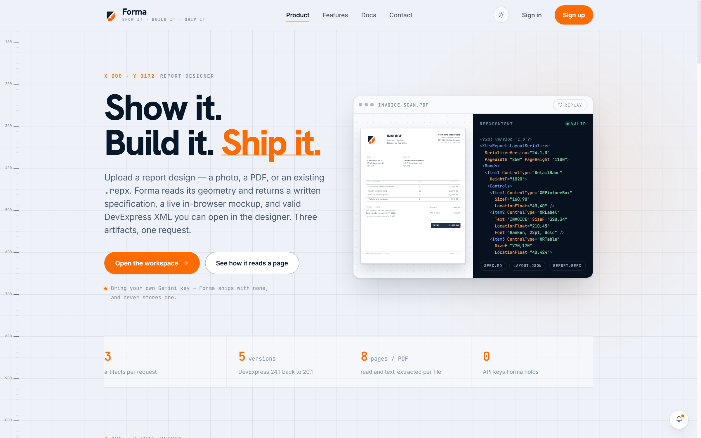
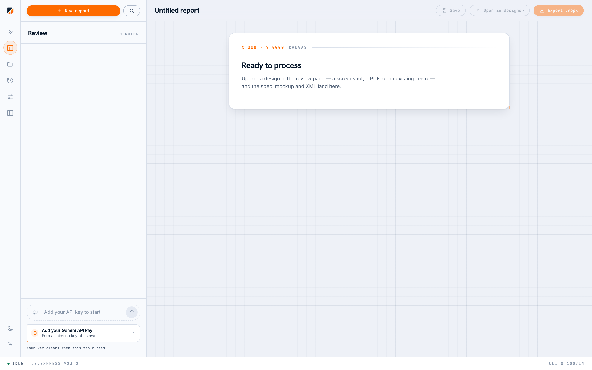

# Forma

Turn a screenshot, a PDF, or an existing report into a real DevExpress `.repx` file.

[](LICENSE)
[](#prerequisites)
[](tsconfig.json)
[](package.json)
[](package.json)

[](https://github.com/waqarsyd/forma/actions)
[](https://github.com/waqarsyd/forma/actions/workflows/live.yml)

Upload a design — a mockup, a scanned invoice, a photo of a printout, or a `.repx` you already have — and Forma returns three things in one pass:

- **`repxContent`** — valid `XtraReportsLayoutSerializer` XML that saves as a `.repx` and opens directly in the DevExpress Report Designer,
- an **in-browser mockup** of its bands, so you can see what it understood before you download anything,
- a **specification**, band by band, of what it holds.

The AI writes only the `.repx`; Forma reads the mockup and the specification out of it, so all three describe the file you download and your tokens are not spent writing it three times ([`src/lib/repxViews.ts`](src/lib/repxViews.ts), since 2026-11-05).

---

## Why this exists

Rebuilding an existing report in the DevExpress designer is mechanical work: read the layout, place the bands, set the units, repeat. Forma does the transcription pass so you start from a `.repx` that already has the right control types and geometry, and spend your time on the parts that need judgement.

It is built around one constraint that shaped everything else: **the application owns no API key.** An earlier build inlined a build-time Gemini key into the shipped JavaScript, and Google's secret scanner found and revoked it. What replaced it is not a patch but an architecture — the browser calls the AI directly, Google or OpenRouter with a key the user supplies or a model on the user's own computer, and no server is ever in the loop.

---

## Demo

**Live at [openforma.web.app](https://openforma.web.app)** — built from `main` and deployed by hand, so it can trail the newest commits: the page names the commit it was built from in `<meta name="forma-version">`, and a check every three hours ([`live.yml`](.github/workflows/live.yml)) says when it is behind `main`. What changed, and when, is on the [changelog](https://openforma.web.app/changelog). It runs signed out with no account, and generating a report needs an AI of your own, set up in Settings: a Gemini or OpenRouter key, which goes from your browser to that service alone, or a model on your own computer through Ollama or LM Studio.



The workspace itself — the uploaded design and the conversation on the left, the rendered mockup on the right, and the `Mockup` / `Spec` / `REPX` tabs over the three artifacts:



Both are real captures of the app at `localhost:3000`, not mockups, but from September 2026: the workspace has changed since (the conversation is a thread down the left, and there is no status bar), and they will be recaptured. See [`docs/media/README.md`](docs/media/README.md) for how they were taken.

---

## Table of contents

- [Why this exists](#why-this-exists)
- [Bring your own AI](#bring-your-own-ai)
- [Features](#features)
- [Tech stack](#tech-stack)
- [Getting started](#getting-started)
  - [Prerequisites](#prerequisites)
  - [Installation](#installation)
  - [Environment variables](#environment-variables)
  - [Running locally](#running-locally)
- [Usage](#usage)
- [Using your own Firebase project](#using-your-own-firebase-project)
- [Configuration](#configuration)
- [Project structure](#project-structure)
- [Scripts](#scripts)
- [Testing](#testing)
- [Deployment](#deployment)
- [Roadmap](#roadmap)
- [Status and limitations](#status-and-limitations)
- [Contributing](#contributing)
- [License](#license)
- [Acknowledgements and contact](#acknowledgements-and-contact)

---

## Bring your own AI

**Forma ships no API key and no AI of its own, and it never will.** To start, it needs an AI of yours, any one of three: a Gemini key (the default), an OpenRouter key and model, or a model on your own computer through Ollama or LM Studio. Until the AI you chose is set up, the message box is locked, and there is no mode without an AI (the owner's rule; from 2026-11-05 until 2026-11-23 it had to be the Gemini key, whichever AI designed). A key goes from your browser straight to Google or OpenRouter — the server is never in the loop and never sees a credential — and a local model needs no key and keeps every request on your computer.

This is not an accident of design. An earlier build inlined a build-time key into the shipped JavaScript; Google's secret scanner found it and revoked it. The architecture that replaced it is deliberate:

| Where the key lives | Lifetime |
|---|---|
| `sessionStorage` | Erased by the browser when the tab closes |
| Firestore (opt-in, signed in, the Gemini key only) | **AES-GCM ciphertext only** |

The optional cloud copy is zero-knowledge: your key is encrypted in your browser with a passphrase derived through PBKDF2-SHA256 (310,000 iterations, per-record salt and IV). The passphrase never leaves your machine, so nobody operating a Forma deployment can read your key.

That also means **a forgotten passphrase is unrecoverable by design.** There is no reset, because a reset would imply the operator could decrypt it.

Every page carries a Content-Security-Policy whose `connect-src` allowlists the handful of origins this app legitimately talks to, and scripts load only from this site, Google's sign-in helper and reCAPTCHA. A key sitting in `sessionStorage` a few components away from model-generated markdown is worth stealing, and the policy narrows what injected script could do with it — **it is not a promise that nothing could leave.** A policy does not govern navigation; Firestore, Gemini and OpenRouter are shared services a script could reach with an attacker's own account; and the contact form's FormSubmit relays to any inbox until it is narrowed to Forma's own alias. The defence that matters is that no script gets in, which React's escaping provides. Adding an origin to that list is a change to what the policy can narrow; see [`src/server/securityHeaders.ts`](src/server/securityHeaders.ts), which carries the full reasoning.

---

## Features

Each of these is a shipped code path, not a plan.

- **Image, PDF, `.repx`, SSRS and FastReport intake.** Drop a mockup, a scan, a photo, or an existing report. PDFs are rasterised *and* have their text layer extracted, so exact strings survive rather than being read back out of pixels ([`src/lib/repxIntake.ts`](src/lib/repxIntake.ts), [`src/lib/pdf.ts`](src/lib/pdf.ts)). An SSRS `.rdl` or `.rdlc` and a FastReport `.frx` open as repaired DevExpress reports, converted in the browser ([`src/lib/importForeign.ts`](src/lib/importForeign.ts)); a Word or Excel template's page, margins, table and fonts become the draft when you ask for a report from it ([`src/lib/docxLayout.ts`](src/lib/docxLayout.ts), [`src/lib/xlsxLayout.ts`](src/lib/xlsxLayout.ts)); and a crooked scan or phone photo is straightened before it is read ([`src/lib/deskew.ts`](src/lib/deskew.ts)). Since 2026-11-11.
- **Your own AI opens it, and Forma's own model works behind it.** Forma ships no key and no AI of its own: it starts once the AI you choose in Settings is set up — Gemini with your free key (the default), OpenRouter's free models with a key and model of your own, or a local AI on your own computer through Ollama or LM Studio with its server and model — and until then the chat box is locked (the owner's rule since 2026-11-05, when it had to be the Gemini key whichever AI designed; any of the three since 2026-11-23; from 2026-11-02 to 2026-11-05 it worked with no AI, which is never coming back). A Gemini key beside OpenRouter is optional: with it the report library can find your reports. Beside a local AI it is not used for that, since finding them sends the request's words to Google ([`src/lib/aiProvider.ts`](src/lib/aiProvider.ts), `librarySearchable`). Forma learned the house style and the kinds of report from the structure of 359 real DevExpress reports (never their words), and that model stands in when the AI cannot answer. It also remembers how you work: say "remember: always use A4 and Tahoma" and every report after follows it, and the reports you keep teach it your house style. The memory, the style and the kept reports are stored in your browser and listed in Settings; what a request needs of them goes to the AI with it, and a signed-in account's learning events, counted and structure only unless you opt in, are kept under the account in Firestore ([`src/lib/offlineGenerator.ts`](src/lib/offlineGenerator.ts), [`docs/proposals/own-model.md`](docs/proposals/own-model.md)). With an AI chosen, the parts work together on each request: OCR reads the words, Forma's own vision model (when you run one) reads the layout, Forma's own model brings the house style, and if the AI cannot answer you get Forma's own draft instead of an error ([`src/lib/formaTeam.ts`](src/lib/formaTeam.ts)). For a picture, Forma drafts the report and the AI only corrects the draft, one short line per control, so a report costs a fraction of the tokens of one the AI designs from nothing ([`src/lib/draftText.ts`](src/lib/draftText.ts), since 2026-11-05).
- **One chat box for everything.** Attach or paste an image, a scan, a PDF or a `.repx`, describe the report you want, or both, and the box works out what to do: an attachment shows as the file alone, and once you send, its text is read with OCR behind the scenes in the browser (PaddleOCR's PP-OCRv5 for an English page since 2026-11-10, in browser workers, and Tesseract.js for the other languages; nothing leaves the browser; English, Arabic, Hindi, Urdu, French, German or Spanish, the language worked out from the page itself), the image viewer offering a review of what was found over the source from which a `.repx` can be built with no model; a description with no attachment gets a question or two in the thread when it leaves something open, then a report designed from it; words and an attachment together go to one generation ([`src/components/Composer.tsx`](src/components/Composer.tsx), [`src/lib/ocrAttach.ts`](src/lib/ocrAttach.ts), [`src/lib/promptToReport.ts`](src/lib/promptToReport.ts)).
- **The AI writes the `.repx`, and Forma reads the rest off it.** Since 2026-11-05 the model answers with the REPX as plain XML and nothing else; the spec and the mockup's `layout` are read off that file ([`src/lib/repxViews.ts`](src/lib/repxViews.ts)), which more than halved what each report asks the model to write. A cut-off answer is detected and repaired rather than downloaded half-written ([`src/lib/repxTruncation.ts`](src/lib/repxTruncation.ts)).
- **Targets your DevExpress version** — eight of them, 26.1 back to 20.1, written into the file's `SerializerVersion` so it drops into the codebase you already have. Worth knowing that the tag is a label rather than a gate: a newer `.repx` still opens in an older designer, which was measured with `RepxProbe inspect` and then confirmed through the product — a 23.2 file opened correctly in a real 20.1 designer, and the designer rewrote the tag on save. There is no picker: the version is read from a report you bring, else the one you last brought, else 23.2 ([`src/lib/autoConfig.ts`](src/lib/autoConfig.ts)), and nothing is lost if it is not the one you build against.
- **In-browser mockup** drawn from the `layout` JSON, so you can see what the model understood before downloading anything.
- **Print preview and PDF export**, and it is the one pane drawn from `repxContent` rather than from the `layout`. The exported REPX is read back, the band rules applied — Detail once per record, PageHeader and PageFooter on every sheet, ReportHeader once, ReportFooter after the last record — and laid out across real pages at true size, so `window.print()` gives a correctly-scaled PDF. **This is what closes the loop:** before it, nothing showed the report paginated and nothing checked the artifact you actually download. A Detail band the height of the page looks fine in the mockup and is obvious here on sight, one record per sheet ([`src/lib/reportPreview.ts`](src/lib/reportPreview.ts), [`src/components/ReportPreview.tsx`](src/components/ReportPreview.tsx)). Export, at the top right, holds that PDF with every other format; beside it, **PDF with outline** writes a PDF of Forma's own: the report's bookmarks as its outline, encrypted under the report's passwords when it has any, and PDF/A-1b, 2b or 3b when the report asks for it, with Liberation fonts embedded and checked with veraPDF ([`src/lib/pdfWriter.ts`](src/lib/pdfWriter.ts), [`src/lib/pdfA.ts`](src/lib/pdfA.ts)).
- **Direct manipulation.** Select, drag, resize; double-click a label to retype it; arrow keys nudge one report unit and Shift+arrow ten, because a drag gets close and one unit at a time gets exact. Undo is one entry per gesture, not per mouse move. Every edit splices the control's opening tag in place, so attributes Forma does not model — `Padding`, `StylePriority`, anything a later DevExpress version adds — survive untouched ([`src/lib/repxEdit.ts`](src/lib/repxEdit.ts)).
- **Data binding, where the report stops being a picture.** Paste a JSON row, a CSV export, a `CREATE TABLE` statement or a plain list of column names — the format is detected from its shape, not chosen from a dropdown. Forma reads the field names, types and a sample value, proposes which report column each belongs to, and lets you correct every pairing before anything is written. Apply writes `ExpressionBindings` onto the mapped Detail cells, plus a `TextFormatString` where a column is plainly money or a date ([`src/lib/dataSource.ts`](src/lib/dataSource.ts), [`src/lib/repxBindingPlan.ts`](src/lib/repxBindingPlan.ts), [`src/components/DataBinding.tsx`](src/components/DataBinding.tsx)).
- **Grouped reports.** When the source breaks its rows into runs by a shared value — a "North Region" heading inside the table, a subtotal repeating partway down — the output carries `GroupHeaderBand` and `GroupFooterBand` with a `<GroupFields>` collection naming the field the rows break on, and a per-group subtotal whose `<Summary>` carries `Running="Group"`. The prompt states a *visible* test for grouping rather than leaving it to judgement, and says to omit both bands when the design shows no break ([`src/lib/reportBands.ts`](src/lib/reportBands.ts)).
- **Report parameters.** A "Date range: ___ to ___" line or a filled-in criteria block becomes a real `<Parameters>` collection, used in the report's `FilterString` (`?DateFrom`) or in a control expression (`[Parameters.Region]`). **The type is the one thing the model cannot write correctly, and it fails silently** — DevExpress accepts `Type="System.DateTime"` inline and loads a `System.String` holding the date as text, so the filter then compares strings. The real form is a `#Ref-N` pointer into an `<ObjectStorage>` block, so the prompt asks for the readable inline type and the conversion happens in code ([`src/lib/repxParameters.ts`](src/lib/repxParameters.ts)).
- **Charts and cross-tabs.** A chart becomes a real `XRChart` with a series bound to the fields the axes name, not a picture of one assembled from labels and rectangles; a matrix whose rows *and* columns are both data values becomes an `XRCrossTab` with its three field collections. Bar, line, area, scatter and pie. Over test data the Preview draws a chart's points and a cross-tab's grid as DevExpress prints them with that data; with none it draws their **structure and binding rather than invented data** — a bar outline captioned "Amount by Region" — because plotting made-up numbers on a page someone is checking for accuracy is worse than plotting none.
- **Batch intake — a folder of legacy reports in, a queue of `.repx` out.** Each source document becomes *its own* report, made as a single report is made, with its pages read and your words followed ([`src/lib/batchRun.ts`](src/lib/batchRun.ts), since 2026-11-11), which is the opposite of attaching several files to the composer, where several pages build one report. Choose files or a folder, or drop either on the panel ([`src/lib/folderDrop.ts`](src/lib/folderDrop.ts) opens a folder to its last file). Files run one at a time by default because your key carries the quota and forty parallel requests turn a slow success into a fast 429; two or three at once are offered for a key that allows it. Each row shows the audit's verdict, since the point of running forty files is knowing which are worth opening. **Download as .zip** takes them all ([`src/lib/batchQueue.ts`](src/lib/batchQueue.ts), [`src/lib/zip.ts`](src/lib/zip.ts) — a store-only writer in ~150 lines rather than a ~30 kB dependency, verified by opening its output with .NET's own `ZipFile` reader). **This is the migration story, and the one thing a prompt-driven competitor structurally cannot offer**: you can describe one report to an assistant, but not forty you have never read.
- **An audit that says what is still wrong** after every repair has run — errors mean content will be lost when DevExpress loads the file, warnings mean it opens and is a worse report than it should be. A chart with no series and a cross-tab missing a field collection both load happily and print an empty frame that reads as "the data has not arrived yet", so both are reported ([`src/lib/repxAudit.ts`](src/lib/repxAudit.ts)).
- **Runtime model detection.** Models are probed against a preference list on first use and the winner is cached for the session. Nothing is hardcoded, because Google retires models "for new users" — a pinned id keeps working for existing projects and 404s for every new key (`resolveModel` in [`src/services/geminiService.ts`](src/services/geminiService.ts), covered by `modelResolution.test.ts` beside it, with the curated preference list in [`src/lib/modelCatalog.ts`](src/lib/modelCatalog.ts)).
- **A workspace as quiet as a chat app.** Working dots while Forma writes and **Stop** in place of the send button; no progress bar, no status bar and no pause, since 2026-11-04. The measured progress is still read to a screen reader ([`src/lib/generationProgress.ts`](src/lib/generationProgress.ts)).
- **Optional sign-in and cloud sync.** Signed out, Forma saves your projects in the browser's IndexedDB (`forma-projects`, since 2026-11-11; [`src/lib/projectStore.ts`](src/lib/projectStore.ts)) and works fully; signed in, reports sync to Firestore under rules that enforce account isolation and cap an account at 1,000 projects ([`firestore.rules`](firestore.rules)). A deleted project can be brought back from the toast for a few seconds ([`src/lib/deferredDelete.ts`](src/lib/deferredDelete.ts)).
- **Checked against your page before you see it.** For a picture whose records Forma could read, the report is printed with those rows and the AI is asked once more about whatever would print wrong: extra pages, text past the margin, a field that prints nothing, totals or number formats that do not reproduce the page ([`src/lib/printCheck.ts`](src/lib/printCheck.ts), [`src/lib/totalsCheck.ts`](src/lib/totalsCheck.ts)). **Compare with the original** on the Preview lays the page under the report ([`src/lib/sourceAlign.ts`](src/lib/sourceAlign.ts)), and a report can carry a second language with a Language switch ([`src/lib/repxTranslate.ts`](src/lib/repxTranslate.ts)). Since 2026-11-11.
- **Zero-knowledge key vault.** AES-GCM encryption in the browser, PBKDF2-SHA256 key derivation ([`src/services/keyVault.ts`](src/services/keyVault.ts)).
- **Version history with a structural diff.** Every generation, refinement and binding pass is kept, each row saying what it changed — controls added, removed, moved, resized, retyped — so a refinement that made the report worse is one click from being undone. Signed in, the newest ten are saved with the project ([`src/lib/revisions.ts`](src/lib/revisions.ts), [`src/lib/revisionStore.ts`](src/lib/revisionStore.ts)).
- **Account deletion that actually deletes**, removing saved reports, their version history and the encrypted key — proven by a test running against the emulator with production rules enforced. The middle one is the part that is easy to miss: Firestore does not delete a subcollection with its parent document, so a report deleted the obvious way leaves its history behind and looks like it worked ([`tests/accountDeletion.test.ts`](tests/accountDeletion.test.ts)).
- **A shared style sheet, derived rather than asked for.** An appearance used by three or more controls is hoisted onto a `<StyleSheet>` after generation, so restyling a migrated report is one edit instead of forty that have to agree. Grouping is on exact equality, which is what makes it provably equivalent. DevExpress prints a style's value over a control's own for every property the style sets, so the lift deletes the hoisted attributes from every member and leaves nothing for the style to override ([`src/lib/repxStyles.ts`](src/lib/repxStyles.ts)).
- **A single place for unit conversion.** Four coordinate systems meet in this pipeline and every conversion between them lives in one module, because a mismatch renders a plausible layout in the wrong place and never throws ([`src/lib/reportGeometry.ts`](src/lib/reportGeometry.ts)).
- **Forma Designer, an optional Windows companion** that opens a generated `.repx` in the real DevExpress designer over a loopback listener, downloadable from [/download](https://openforma.web.app/download) and installed per user. Open in designer opens a dialog that asks the companion only when clicked and says what is missing: Forma Designer, DevExpress Reporting (whose free trial it links), the browser's permission, or Windows. Export `.repx` needs none of it ([`tools/RepxDesigner/`](tools/RepxDesigner/), [`src/lib/designerBridge.ts`](src/lib/designerBridge.ts), [`src/components/OpenInDesigner.tsx`](src/components/OpenInDesigner.tsx)).
- **Mock mode** — `VITE_FORMA_MOCK=true` returns a canned invoice after a 3s delay, for exercising the workspace without spending a request.

---

## Tech stack

| Layer | Choice |
|---|---|
| UI | React 19, Tailwind v4 (no config file — CSS-first), Motion for animation |
| Build | Vite 8 (Rolldown), esbuild for the server bundle |
| Language | TypeScript, `strict` enabled |
| Server | Express 5 — the **same** `server.ts` in development and production |
| AI | `@google/genai`, called from the browser; or Ollama, LM Studio and OpenRouter through their OpenAI-compatible API ([`compatClient.ts`](src/services/compatClient.ts)) |
| OCR | PaddleOCR (PP-OCRv5) on ONNX Runtime Web for English, Tesseract.js for the other languages, both in the browser |
| Auth & storage | Firebase Auth + Firestore, both optional |
| Documents | `pdfjs-dist` for PDF intake, `react-markdown` + `remark-gfm` for the spec |
| Hosting | Firebase Hosting, served statically ([Deployment](#deployment)) |
| Tests | Vitest, `@firebase/rules-unit-testing` against the Firestore emulator |

There is no ESLint config, no state-management library, no date library, no HTTP client (native `fetch`), and no icon package — the icons are inline SVG.

---

## Getting started

### Prerequisites

- **Node 24.15.0 or later on 24, or 26+** (`^24.15.0 || >=26`; `node -v; npm -v` prints what you have). Node 22 is out since 2026-11-21: Firebase 13's own packages ask for Node 24.12 or later, and jsdom, which the tests run on, then needs 24.15.0 on that line. Node 20 reached end of life on 2026-04-30. The odd-numbered **25 is outside the range too**, even though it is newer: jsdom and Vitest both skip it.
- **An AI of your own**: a Gemini API key from [Google AI Studio](https://aistudio.google.com/apikey), an OpenRouter key, or Ollama or LM Studio on your own computer — set up in the app at runtime, never in a file.
- **A JRE** — only for `npm run test:rules`, which starts the Firestore emulator (a JVM process). A runtime is enough; no JDK.
- **A Firebase project** — only if you want sign-in and cloud sync. Everything else works without one.

<sup>`package.json`'s `engines` field is the declaration; several other files restate it, and the table *Facts stated in more than one file* in [`CLAUDE.md`](CLAUDE.md) lists every copy, so raising the floor is a change to each of them.</sup>

### Installation

```bash
git clone https://github.com/waqarsyd/forma.git
cd forma

npm install
```

Contributors should use `npm ci` instead — it installs exactly what the lockfile specifies and fails if `package.json` and `package-lock.json` disagree, which is a check nothing else performs.

### Environment variables

**All five are optional, and none is a secret.** Copy [`.env.example`](.env.example) to `.env` only if you need one of them; `server.ts` loads it via `dotenv/config`.

| Name | Required | Default | Description |
|---|---|---|---|
| `VITE_FORMA_MOCK` | No | unset | Set to `"true"` to skip Gemini entirely and return a canned mock invoice after a 3s delay. Local development only. The value `"misordered"` returns the same fixture with its two header bands swapped, so the REPX audit's band-order warning can be seen firing in the running app; `"true"` stays deliberately clean. |
| `VITE_FIREBASE_EMULATORS` | No | unset | Set to `"true"` to sign in and save against the local Auth and Firestore emulators instead of the real project (start them first: `npx firebase emulators:start --only auth,firestore`). Development only; accounts made there vanish when the emulators stop. |
| `PORT` | No | `3000` | The port the server listens on. Useful for a second instance beside a running dev server; a value that is not a port falls back to 3000. |
| `HOST` | No | loopback in dev, all interfaces in production | Which interface the server binds. Set to `0.0.0.0` only to reach the dev server from another device — that publishes Vite's module graph to anything that can reach the machine. |
| `HTTPS` | No | unset | Set to `"true"` **only where TLS actually terminates**, so the server sends HSTS. Never set it locally: a browser that receives HSTS on `http://localhost` refuses plain-HTTP localhost for a year afterwards, breaking every other project on the machine. |

> **A `GEMINI_API_KEY` in `.env` does nothing.** `vite.config.ts` allowlists `VITE_*` only, so it reaches neither the server nor the browser. It just sits in your working tree waiting to be committed. The key belongs in the app's Settings dialog.

### Running locally

```bash
npm run dev
```

Open <http://localhost:3000/workspace>; the locked message box's button opens **Settings** where the AI you chose is set up — at **Gemini key** for Automatic, the default, or at **AI** for a local model or OpenRouter — and what you enter takes effect at once.

That's enough to generate reports. Sign-in and cloud sync are optional — signed out, Forma saves your projects in your browser (IndexedDB) and works fully.

> **Never run `vite dev` directly.** The dev server is [`server.ts`](server.ts), an Express app that runs Vite in middleware mode. `npm run dev` is the entry point.

---

## Usage

**Generate a report from a design:**

1. `npm run dev`, then open <http://localhost:3000/workspace>.
2. Set up your AI: **Settings → Gemini key** → paste your key (it goes to `sessionStorage` and is erased when the last Forma tab closes), or **Settings → AI** → **Local AI** with a model, or **OpenRouter** with its key and a model.
3. Attach an image, a scan, a PDF or a `.repx` to the message box, describe the report you want, or both.
4. Send. Working dots show while the AI writes, and **Stop** ends it; the report opens over the whole bench when it is done.
5. Check it in **Preview**, ask the chat for changes, then take the `.repx` from **Export**.

**Develop against a canned response, spending no quota:**

```bash
echo 'VITE_FORMA_MOCK="true"' > .env
npm run dev
```

**Serve a production build:**

```bash
npm run build      # client bundle + server bundle into dist/
npm start          # node dist/server.cjs — must run from the repo root
```

**Mirror dev-server output to a file** (useful when something needs reading back rather than watching):

```bash
npm run dev:log    # same server; output tee'd to dev-server.log (gitignored)
```

**Open a generated `.repx` in the real DevExpress designer** (Windows, optional): download Forma Designer from [the download page](https://openforma.web.app/download), or build it from [`tools/RepxDesigner/`](tools/RepxDesigner/), and double-click it to install it for your user. **Open in designer** then hands the report over, from the website or a Forma running on your PC, and says what is missing when something is. It needs DevExpress Reporting 20.1 or later on the same PC. Start it from your own desktop — a process launched elsewhere paints on a desktop nobody can see. See its [README](tools/RepxDesigner/README.md).

---

## Using your own Firebase project

Sign-in and cloud storage need a Firebase project. Skip this entirely if you only want local use.

1. Create a project at [console.firebase.google.com](https://console.firebase.google.com/) and register a **Web app**.
2. **Authentication → Get started → Sign-in method → Google → Enable.** The tabs stay hidden until you click *Get started*, which is the usual stumbling block.
3. **Authentication → Settings → Authorized domains** — confirm `localhost` is listed, and add your deployment domain.
4. **Firestore Database → Create database** (production mode).
5. Put your web config into `firebase-applet-config.json`, and make sure `firestoreDatabaseId` there matches `databaseId` in `firebase.json` — **a mismatch silently talks to the wrong database.**
6. Set the deploy target in `.firebaserc`, then `npx firebase deploy --only firestore:rules`.

`.firebaserc` is what decides the deploy target. `firebase use <id>` only sets the CLI's own per-directory state, so a stale `.firebaserc` will happily deploy to the wrong project from a fresh shell or from CI.

**The `AIzaSy…` string committed in `firebase-applet-config.json` is correct and should stay.** A Firebase web API key is a public project identifier, not a secret — it ships in every Firebase web app by design, and `firestore.rules` plus the authorized-domain list are what actually protect your data. It is not the same class of value as a Gemini key.

**Restrict it anyway, by HTTP referrer, before your repository is public.** Public by design is not the same as unlimited: an unrestricted key is accepted from any origin, so anyone who finds it can spend your project's quota. Rules still stop them reading your data — this is a cost problem, not a data one — but GitHub is crawled for `AIzaSy` strings, so the window opens the moment the repo is. GCP Console → APIs & Services → Credentials → *Browser key (auto created by Firebase)* → Application restrictions → HTTP referrers.

Two traps in that list, both of which fail silently:

- **Include your `authDomain`** — `<project>.firebaseapp.com/*`. Google sign-in runs through `/__/auth/handler` on that domain using this key, so a list of just your own site breaks sign-in and nothing else, which is a hard symptom to trace back.
- **The list replaces, it does not append.** Adding a production domain later means re-sending every entry that must keep working.

Verify it rather than assuming: a `GET` to `identitytoolkit.googleapis.com/v1/recaptchaParams?key=…` with a forged `Referer` should answer `403 Requests from referer … are blocked`, and the same call with an allowed one should answer `200`. Restrictions take a few minutes to propagate.

---

## Configuration

Beyond the environment variables above, two things are configurable.

**`firebase-applet-config.json`** — your Firebase web config. `firestoreDatabaseId` must match `databaseId` in [`firebase.json`](firebase.json).

**Report settings are worked out, not asked for** (since 2026-11-04). Forma reads them from what each request brings ([`src/lib/autoConfig.ts`](src/lib/autoConfig.ts)): the paper and orientation, the header and footer, right to left, the stored procedure, the OCR language and handwriting. Only two are remembered between requests, through an explicit allowlist in [`src/lib/reportConfigStore.ts`](src/lib/reportConfigStore.ts), and both are learned rather than chosen:

| Setting | How it is set |
|---|---|
| DevExpress version | Read from a report you bring, else the one you last brought, else 23.2. |
| Report unit | Read the same way. Every conversion between coordinate systems goes through [`reportGeometry.ts`](src/lib/reportGeometry.ts). |

A data schema is pasted in the **Data** tab, or browsed from a SQL Server database through Forma Designer. See [`docs/PRD.md`](docs/PRD.md) §2.4.

---

## Project structure

The top level, in brief. The full tree, with a note on every file that needs one, is [`docs/project-structure.md`](docs/project-structure.md).

| Path | What it holds |
|---|---|
| `src/` | The app: `main.tsx` (the entry), `PublicSite.tsx` (every public page), `App.tsx` (the workspace), `components/`, `lib/` (the pure helpers, nearly all under test), `services/` (the AI calls and the key vault), `server/` (what `server.ts` imports) and `mcp/` (Forma's MCP server, run on stdio from a clone) |
| `server.ts` | Express: Vite in middleware mode in development, and `dist/` served statically by `npm start` |
| `scripts/` | The checks, the build, the deploy and release scripts, the fidelity benchmark and Forma's own model tooling |
| `tools/` | Forma Designer (`RepxDesigner/`), the optional Windows companion, and `RepxProbe/`, which asks DevExpress what a `.repx` contains |
| `tests/` | The Firestore rules suite, run against the emulator |
| `docs/` | The product spec (`PRD.md`), the architecture notes (`notes/`), proposals, the design source, deploying and screenshots |
| `assets/` | Forma's own model, the PDF fonts, and the sources generated images are drawn from |
| `public/` | Vite's static root, copied into `dist/` as it is: icons, logos and the web manifest |
| `.github/` | CI, CodeQL, the live-site check, Dependabot, the issue forms and the `main` ruleset |

---

## Scripts

| Command | What it does |
|---|---|
| `npm run dev` | Express + Vite middleware on port 3000 |
| `npm run dev:log` | Same, mirrored to `dev-server.log` |
| `npm run build` | Client bundle + server bundle into `dist/` |
| `npm run build:server` | Server bundle only (`dist/server.cjs`, via esbuild) |
| `npm start` | Serve the production build (run `build` first, from the repo root) |
| `npm run preview` | Vite preview against `dist/` |
| `npm run lint` | `tsc --noEmit` |
| `npm run lint:encoding` | Fails if any source file contains mojibake |
| `npm run lint:links` | Fails if a relative link or a cited section heading in the docs does not resolve |
| `npm run check:size` | Artifact size budgets — run `build` first |
| `npm run check:hierarchy` | Every place the current change must also reach (the Features and Docs pages, the release notes, the spec, the notes, the layout), from [`docs/project-hierarchy.md`](docs/project-hierarchy.md); the pre-commit hook runs it on every commit, and `-- --reviewed` records a review it asks for |
| `npm run smoke` | Checks the deployed site over the network: every route, the entry chunk, the headers, the feed, and once it runs `main`'s build, a 404 for an unknown path and a missing chunk. Read-only; `.github/workflows/live.yml` runs it every three hours |
| `npm run fetch:paddle` | Download PaddleOCR's text detector and English recogniser (12.7 MB, pinned by SHA-256) into `vendor/paddle/` for the next build; `scripts/deploy.mjs` runs it, and a build without it reads pictures with Tesseract alone |
| `npm run fetch:handwriting` | Download the handwriting model (about 64 MB, pinned by SHA-256) into `vendor/handwriting/`; only a build that asks for it by name (`FORMA_HANDWRITING=1`) ships it — see *Handwriting is a deploy-time decision* in [`docs/deploying.md`](docs/deploying.md) |
| `npm test` | Unit tests (Vitest; `node` by default, jsdom per file where needed) |
| `npm run test:watch` | The same suite in watch mode |
| `npm run test:coverage` | Coverage over `lib/`, `services/`, `server/` and `mcp/`, held to the thresholds in `vitest.config.ts` — see the note there about what is deliberately excluded |
| `npm run test:rules` | Firestore security-rule tests — **needs Java** |
| `npm run bench:fidelity` | The fidelity benchmark: generates every case under `scripts/fidelity/cases` through the real pipeline with your own key (`FORMA_BENCH_KEY`) and scores the result. A benchmark, not a check — it spends quota, so it is not in CI |
| `npm run model:train` | Learns Forma's own model (`assets/model/formaModel.json`) from a folder of `.repx` reports, from their structure only, and refuses to write it if any word of theirs would reach it. Takes `--reports` and `--data` (a folder outside the repository); see `docs/proposals/own-model.md` |
| `npm run model:dataset` | Packs those skeletons as a private Kaggle dataset for the vision model: every rare font made Arial, every target checked for stray words, nothing written if one is left. Takes `--data` (more than one set allowed) and `--out` (outside the repository). Then `python scripts/model/render.py <out>` draws each skeleton as page images with placeholder text. Crystal Reports `.rpt` files become a set through `scripts/model/crystal.ps1` and `crystal.ts`, which need the Crystal runtime 13 |
| `npm run mcp` | Forma's MCP server on stdio (`src/mcp`), for development from the clone. Not the command a host runs: npm prints its banner to stdout, which the protocol forbids, and a host starts the server in your project, where npm would run that project's own scripts. A host runs `node <clone>/src/mcp/run.mjs`, after a full `npm ci` in the clone |
| `npm run clean` | Remove `dist/` |

Not an npm script, and not a check: `npx tsx scripts/repx.ts audit|repair|pdf <file.repx>` runs Forma's REPX audit, its repair chain or a draft PDF on one file from the command line (2026-11-11), for a person or a coding assistant working on a report outside the web app; `audit` exits 1 on an error, so it can gate a build. What each finding and repair means is [`docs/skills/devexpress-repx/SKILL.md`](docs/skills/devexpress-repx/SKILL.md).

<sup>Two other files list these: [`CONTRIBUTING.md`](CONTRIBUTING.md)'s table of checks and [`CLAUDE.md`](CLAUDE.md)'s *Commands* block. Adding or renaming a script is a change to all three — this table is the one users read, so it lists every script rather than only the checks.</sup>

---

## Testing

```bash
npm test           # pure helpers: REPX validation, crop geometry, stream parsing, routing
npm run test:rules # security rules, against the Firestore emulator
```

Run one file with `npx vitest run src/lib/repx.test.ts`, or one case with `-t "<name>"`. Narrowing buys focused output first; how much time it saves depends on the cache, and [`docs/notes/testing.md`](docs/notes/testing.md) — *Running one file, and what that does not buy you* says why no timing is written down.

The unit suite deliberately targets functions whose invariants **fail plausibly rather than loudly** — a transposed crop box puts a logo somewhere believable but wrong; a mis-scanned stream shows a stray character in a chat bubble. Those are the failures that survive manual testing.

The rules suite covers account isolation, document shape, and the encrypted key vault. It needs a JVM because the Firestore emulator is a Java process; a **runtime is enough — no JDK required.** Any Java 21 runtime on `PATH` will do, and `JAVA_HOME` is not needed (a Temurin JRE 21 is what it is developed against).

Coverage of React components is a handful of render tests — the first, `DataBinding` and `BatchPanel`, added after a state bug shipped that a render test would have caught; the note linked below lists the rest — and `App.tsx`'s own stateful logic is covered only where pieces of it have been extracted into `src/lib`. **This is a floor, not a net.** [`docs/notes/testing.md`](docs/notes/testing.md) says exactly what is and is not covered.

If a run is slow, or every jsdom file fails at once with a worker timeout, see [`docs/notes/testing.md`](docs/notes/testing.md) — *A cold cache can look exactly like a broken install*.

---

## Deployment

There is no Dockerfile and no container setup. Forma builds to a self-contained Express bundle:

```bash
npm run build      # vite build + esbuild -> dist/
npm start          # node dist/server.cjs, from the repo root
```

`scripts/build-server.mjs` bakes in `NODE_ENV=production`, so the built server takes the static-file branch and the Vite import is dead code. The static path is `process.cwd()/dist`, which is why `npm start` must run from the repo root. In production the server also mounts `compression()` and serves hashed bundles with an immutable cache policy — `index.html` deliberately excepted, or a deploy would never reach a returning visitor.

Set `HTTPS="true"` **only where TLS actually terminates**, so HSTS is sent. Set `HOST` if you need to bind something other than the default.

### Firebase Hosting

The live sites, [openforma.web.app](https://openforma.web.app) and [forma-201ba.web.app](https://forma-201ba.web.app), are Firebase Hosting on the free Spark plan, served statically: the app keeps no server state, since Firestore and the AI are called from the browser with the user's own key. `node scripts/deploy.mjs` is the one way to deploy them: every check, the build, hosting with the Firestore rules and indexes, the live checks, then a numbered GitHub release. `--preview` puts the same build on a 7-day preview channel first.

How the deploy works, rolling back, the free plan's limits, adding a site, the derived security headers and the settings only the owner can apply are in [`docs/deploying.md`](docs/deploying.md).

---

## Roadmap

The roadmap is section 6 of [`docs/PRD.md`](docs/PRD.md), which is kept current against the code. On GitHub each item is a [milestone](https://github.com/waqarsyd/forma/milestones), and the pinned *Roadmap* discussion carries the same text; [`scripts/github-setup.mjs`](scripts/github-setup.mjs) makes both from that section. Ideas are welcome in [Discussions](https://github.com/waqarsyd/forma/discussions/categories/ideas).

- **PDFs past eight pages.** Raise or remove the 8-page cap, and support multi-page `.repx` datasets.
- **Editing by hand on the Preview:** deleting and adding a control, editing a table cell's text, and multi-select. Move, resize, retype, keyboard nudge and per-gesture undo are done, and the chat already deletes and adds controls.
- **Real barcodes**, encoded from their value: the Preview draws a barcode as a placeholder of bars, and the mockup draws gauges, barcodes and charts as placeholders. The exported `.repx` carries the real controls.
- **A password-strength indicator** at sign-up. The minimum of eight characters, the verification email and the verified address sharing needs are done.
- **The report library, moved into the notes.** It was evaluated on a real report on 2026-11-09 ([`docs/proposals/rag.md`](docs/proposals/rag.md): a restyle with the house style matched the house font where none did without it), and since 2026-11-11 the reports you keep join it on their own; graduating its reasoning from the proposal into `docs/notes/` is the step left.

Deliberately out of scope, each with its reasons in [`docs/PRD.md`](docs/PRD.md) §6: a server or a browser holding a customer's database credential, moving generation server-side, and replacing the direct Gemini call with MCP.

---

## Status and limitations

Forma is usable but young, and some things are worth knowing before you rely on it:

- **Generation is slow**, typically a minute or more. Most of that is the model reasoning before it emits any output — measured at 4,770 thinking tokens against 3,184 output tokens on a representative run.
- **Gauges and barcodes in the mockup are decorative placeholders**; charts follow the supplied values but are stylised rather than a real charting library. The exported `.repx` still carries the correct DevExpress control types.
- **Models are detected at runtime, never hardcoded.** Google retires models "for new users", so a pinned id works for existing projects and 404s for every new key. Forma probes a preference list on first use and caches the winner for the session.
- **Reports with large images may not sync to the cloud.** A single detailed 2048px upload can exceed Firestore's 1 MiB document limit on its own; Forma saves the spec and REPX without the images in that case, and says so.
- **PDFs are read to 8 pages.** For a longer one, the first seven and the last page are read; the pages between are skipped, and the notice says so. A single upload is capped at **20 MB** and a request at **12 attachments**; anything over either is reported on screen rather than dropped silently.
- **Component coverage is partial.** Some components have render tests (among them `ChatThread`, `Composer`, `ReportPreview`, `SettingsDialog` and `ShareDialog`; [`docs/notes/testing.md`](docs/notes/testing.md) lists them all), the public pages' claims, numbers, contrast and routes are held by tests that read their source, and every page's links and ids by one that renders it as the build does ([`src/prerender.test.ts`](src/prerender.test.ts)); the rest have none, and `App.tsx` is still several thousand lines of which only the pieces extracted into `src/lib` are tested. The rest of its stateful logic is still checked by hand, or by driving the real app — see `.claude/skills/run-forma/`. (No line count here on purpose: it was written down as "4,500" and was wrong within a week. Measure it if you need it.)

---

## Contributing

Start with **[`CONTRIBUTING.md`](CONTRIBUTING.md)** — setup, the flow from fork to pull request (`npm ci`, the pre-commit guard, the seven checks), and the rules for adding and removing things. Questions go to [Discussions](https://github.com/waqarsyd/forma/discussions); [`.github/SUPPORT.md`](.github/SUPPORT.md) says where everything else goes.

Four documents carry the reasoning that the code cannot:

- **[`CONTRIBUTING.md`](CONTRIBUTING.md)** — the seven checks and the rules for adding and removing things; the one to read before you open a PR.
- **[`CLAUDE.md`](CLAUDE.md)** — the entry point: hard constraints, commands, and an index that routes you to the note covering whatever you are about to change.
- **[`docs/notes/`](docs/notes/)** — five notes carrying the architecture and its incident history: [`gemini.md`](docs/notes/gemini.md), [`app-shell.md`](docs/notes/app-shell.md), [`persistence.md`](docs/notes/persistence.md), [`styling.md`](docs/notes/styling.md), [`testing.md`](docs/notes/testing.md). Most of it explains *why* something is the way it is, usually because the obvious alternative broke. Read the one covering what you're touching before you change it.
- **[`docs/PRD.md`](docs/PRD.md)** — the product specification, kept current against the code.

A few rules worth knowing up front:

- **No Gemini key in any committed file**, `.env` included. `vite.config.ts` allowlists `VITE_*` only, so a key placed there reaches neither the server nor the browser — it just sits in your working tree waiting to be committed.
- **A failed sign-in is a failure.** There is deliberately no fallback that fabricates a session when Firebase is misconfigured; one existed, and it was an authentication bypass on any unrecognised deployment domain.
- **`public/` is Vite's static root** — everything in it is copied verbatim into `dist/` and served publicly. Design notes and internal documents belong in `docs/`.
- **Never edit source through PowerShell's `Get-Content`/`Set-Content`.** It decodes with the ANSI codepage and turns every UTF-8 character into mojibake, which compiles and passes every test. `npm run lint:encoding` is the guard.

Participation is governed by the [Code of Conduct](CODE_OF_CONDUCT.md). Security issues go through [`SECURITY.md`](SECURITY.md), not the public tracker.

---

## License

[Apache License 2.0](LICENSE). You may use, modify and distribute this code, including commercially, provided you keep the licence and copyright notice and state what you changed. It also grants a patent licence from every contributor, which a permissive licence without one does not.

Declared in four places, and they must agree: the `LICENSE` file, the `license` field in `package.json`, the SPDX header in `src/App.tsx`, and this section. (This sentence said "three places" and omitted the one it is written in, which is exactly the copy most likely to be missed when the licence changes.)

---

## Acknowledgements and contact

- **DevExpress** for the `XtraReportsLayoutSerializer` format this project generates. Forma is not affiliated with or endorsed by DevExpress.
- **Google** for Gemini and the `@google/genai` SDK.
- The three typefaces are self-hosted under the SIL Open Font License — Hanken Grotesk, Inter and JetBrains Mono. Licences and per-family copyright are committed in [`src/fonts/`](src/fonts/).
- Code of Conduct adapted from the [Contributor Covenant](https://www.contributor-covenant.org/).

**Contact:** waqarsayyed.official@gmail.com — or, for anything that could expose an API key or someone's saved reports, follow [`SECURITY.md`](SECURITY.md) rather than opening a public issue.
